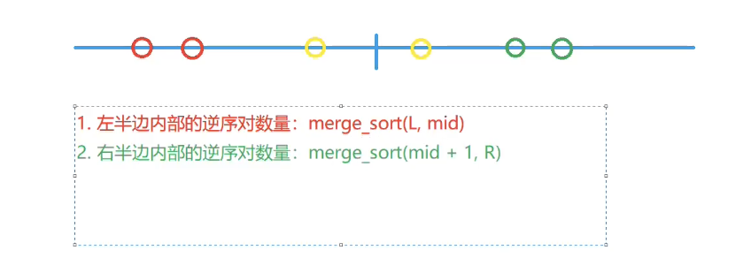

基础算法详解

<!-- MORE -->

## 快速排序（分治）

### 过程

1、确定分界点：$q[l],q[r],q[\dfrac{l+r}{2}]$ 都可以作为分界点 $x$。

2、调整区间：把 $\le x$ 的都放在数组左边，$\ge x$ 的都放在数组右边。（划分方式是快排的重点）

3、递归分别处理左右两边。

### 实现思路

#### 1、开双数组暴力存放

枚举数组里面的每一个数，如果 $\le x$ 就放在 $a$ 数组中，反之放在 $b$ 数组中。

然后把原始数组 $q$ 先用 $a$ 赋值，再用 $b$ 赋值即可。

#### 2、双指针

左指针为 $l$，右指针为 $r$。

如果 $q[l]\le x$，那就往右走一步，$l$ 变为 $l+1$。

如果 $q[r]\ge x$，那就往左走一步，$r$ 变为 $r-1$。

一直到两个都停下了，`swap` $q[l]$ 和 $q[r]$，$l+1,r-1$ 即可。

如此便能是左边的都 $\le x$，右边的都 $\ge x$。

### 代码实现

```cpp
#include <bits/stdc++.h>
using namespace std;

const int N=1e6+7;

int q[N];
int n;

void quick_sort(int q[],int l,int r){
    if (l>=r) return;
    int x=q[(l+r)>>1],i=l-1,j=r+1;
    while(i<j){
        do i++;while(q[i]<x);
        do j--;while(q[j]>x);
        if (i<j) swap(q[i],q[j]);
    }
    quick_sort(q,l,j);
    quick_sort(q,j+1,r);
}

signed main(){
    scanf("%d",&n);
    for (int i=1;i<=n;i++) scanf("%d",&q[i]);
    quick_sort(q,1,n);
    for (int i=1;i<=n;i++) printf("%d ",q[i]);
    return 0;
}
```

### 例题 
题目：第 $k$ 个数

题意：给定一个长度为 $n$ 的整数数列，以及一个整数 $k$，请用快速选择算法求出数列从小到大排序后的第 $k$ 个数。

范围：$n\le 10^7,1\le k \le n$，每个数不超过 $10^9$。

解法：同样是递归的思想，只不过不需要两边都递归，第 $k$ 个数在那边就往那边递归。如此，由于每次只用递归一边，理想复杂度为 $n+\dfrac{n}{2}+\dfrac{n}{4}+...\le 2 \times n$，$O(n)$ 复杂度便可求解。

```cpp
#include <bits/stdc++.h>
using namespace std;

const int N=1e5+7;

int n,k;
int q[N];

int k_th(int l,int r,int k){
    if (l==r) return q[l];
    int i=l-1,j=r+1,x=q[(l+r)>>1];
    while(i<j){
        do i++;while(q[i]<x);
        do j--;while(q[j]>x);
        if (i<j) swap(q[i],q[j]);
    }
    int sl=j-l+1;
    if (k<=sl) return k_th(l,j,k);
    else return k_th(j+1,r,k-sl);
}

signed main(){
    scanf("%d%d",&n,&k);
    for (int i=1;i<=n;i++) scanf("%d",&q[i]);
    printf("%d\n",k_th(1,n,k));
    return 0;
}
```

## 归并排序（分治）

### 过程

1、确定分界点：$mid=\dfrac{l+r}{2}$

2、递归排序左右两边

3、归并——合二为一（归并排序的终点）

### 实现思路

通过 `2` 操作我们已经得到两个有序的数组，下面对两个数组进行合并。

记录两个指针 `x,y`，如果 $q[x]<q[y]$ 就把 $q[x]$ 加入新开数组中，反之就把 $q[y]$ 加入，如此便能用 $O(n)$ 的复杂度进行两个有序数组的合并。

算上合并的次数（$log_2n$），复杂度为 $O(nlog_2n)。$

### 代码实现

```cpp
#include <bits/stdc++.h>
using namespace std;

const int N=1e5+7;

int n,q[N],tmp[N];

void merge_sort(int q[],int l,int r){
    if (l>=r) return;
    int mid=(l+r)>>1;
    merge_sort(q,l,mid);
    merge_sort(q,mid+1,r);
    int cnt=0,i=l,j=mid+1;
    while(i<=mid&&j<=r){
        if (q[i]<=q[j]) tmp[++cnt]=q[i++];
        else tmp[++cnt]=q[j++];
    }
    while(i<=mid) tmp[++cnt]=q[i++];
    while(j<=r) tmp[++cnt]=q[j++];
    for (int i=l,j=1;i<=r;i++,j++) q[i]=tmp[j];
}

signed main(){
    scanf("%d",&n);
    for (int i=1;i<=n;i++) scanf("%d",&q[i]);
    merge_sort(q,1,n);
    for (int i=1;i<=n;i++) printf("%d ",q[i]);
    return 0;
}
```

### 例题

题目：逆序对的数量

题意：给定一个长度为 $n$ 的整数数列，请你计算数列中的逆序对的数量。
逆序对的定义如下：对于数列的第 $i$ 个和第 $j$ 个元素，如果满足 $i<j$ 且 $a[i]>a[j]$，则其为一个逆序对；否则不是。

范围：$n\le 10^5$，每个数不超过 $10^9$。

解法：同样是分治来做。

可以发现在上述归并排序合并两有序数组的过程中正好可以统计逆序对的数量。

左边的逆序对数目可以在左边遍历的时候统计，右边的逆序对数目同理可以在右边统计，重点来到两个数组合并是怎么统计数目。



发现在归并排序的过程中，两个指针向后移动，对于一组 `i,j`，如果 $q[i]>q[j]$，那么说明 $q[i]$ 一直到 $q[mid]$ 都可以和 $q[j]$ 形成逆序对。

因为我们统计的是两边合并产生的逆序对数量，所以左右两边排序对合并产生的逆序对不产生影响。

```cpp
#include <bits/stdc++.h>
#define LL long long
using namespace std;

const int N=1e5+7;

int n,q[N],tmp[N];

LL inversion_pair(int q[],int l,int r){
    if (l>=r) return 0;
    int mid=(l+r)>>1;
    LL ans=0;
    ans+=inversion_pair(q,l,mid);
    ans+=inversion_pair(q,mid+1,r);
    int i=l,j=mid+1,cnt=0;
    while(i<=mid&&j<=r){
        if (q[i]>q[j]){
            tmp[++cnt]=q[j++];
            ans+=mid-i+1;
        }
        else tmp[++cnt]=q[i++];
    }
    while(i<=mid) tmp[++cnt]=q[i++];
    while (j<=r) tmp[++cnt]=q[j++];
    for (int i=l,j=1;i<=r;i++,j++) q[i]=tmp[j];
    return ans;
}

signed main(){
    scanf("%d",&n);
    for (int i=1;i<=n;i++) scanf("%d",&q[i]);
    printf("%lld\n",inversion_pair(q,1,n));
    return 0;    
}
```

## 二分

二分的关键并非单调性，而是要保证在二分的区间中，左右两边一边符合目标条件，另一边不符合，如此便可以进行二分。

### 整数二分有两种写法：

#### 1

```cpp
    while(l<r){
        int mid=(l+r)>>1;
        if (check(mid)) r=mid;
        else l=mid+1;
    }
```
#### 2

```cpp
    while(l<r){
        int mid=(l+r+1)>>1;
        if (check(mid)) l=mid;
        else r=mid-1;
    }
```

两者的区别在于目标条件在右方还是左方，唯一的区别在于第二种写法需要 `mid=(l+r+1)>>1`，这是 `c++` 整数除法下取整带来的必然结果，如果此时 `r=l+1`，`mid` 就会重新变为 `l`，循环往复，`while` 进入了死循环。

### 例一：

#### 题意：

给定一个按照升序排列的长度为 $n$ 的整数数组，以及 $q$ 个查询。

对于每个查询，返回一个元素 $k$ 的起始位置和终止位置（位置从 $0$ 开始计数）。

如果数组中不存在该元素，则返回 `-1 -1`。

#### 分析：

需要二分的位置分别为出现的第一个位置和最后一次出现的位置。

判断二分条件： `q[i]>=x` 和 `q[i]<=x` 

选择二分写法：`q[i]>=x` 目标二分点在左边，选择第一种，`q[i]<=x` 同理。

#### 代码：

```cpp
#include <bits/stdc++.h>
using namespace std;

const int N=1e5+7;

int n,q[N],m;

signed main(){
    scanf("%d%d",&n,&m);
    for (int i=0;i<n;i++) scanf("%d",&q[i]);
    while(m--){
        int x;scanf("%d",&x);
        int l=0,r=n-1;
        //寻找左端点
        while(l<r){
            int mid=(l+r)>>1;
            if (q[mid]>=x) r=mid;
            else l=mid+1;
        }
        if (q[r]!=x){
            printf("-1 -1\n");
            continue;
        }
        else {
            printf("%d ",r);
            //寻找右端点
            l=0,r=n-1;
            while(l<r){
                int mid=(l+r+1)>>1;//有-1必+1
                if (q[mid]<=x) l=mid;
                else r=mid-1;
            }
            printf("%d\n",l);
        }
    }
    return 0;
}
```

### 例二（浮点型）

#### 题意：

给定一个浮点数 $n$，求它的三次方根。

#### 分析：
单调所以保证了二分一边符合目标条件，而一边不符合。

浮点型的写法要注意，如果题目要求 `1e-6`，那么二分的时候要二分到 `1e-8` 来保证正确性（经验所得）。

#### 代码：
```cpp
#include <bits/stdc++.h>
using namespace std;

signed main(){
    double x;scanf("%lf",&x);
    double l=-10000,r=10000;
    while(r-l>1e-8){
        double mid=(l+r)/2;
        if (mid*mid*mid>=x) r=mid;
        else l=mid;
    }
    printf("%.6f",r);
    return 0;
}
```

## 双指针

双指针有两类。

第一类：一个指针指向左边的数组，另一个指针指向右边的数组，例如归并排序的合并过程。

第二类：指向同一个数组，两个指针维护一个区间，例如快速排序的划分过程。

写法上一般是一种写法：

```cpp
    for (int i=0,j=0;i<n;i++){
        while(j<i&&check(i,j)) j++;

        //每道题目的具体逻辑
    }
```

核心思想：

运用了某些单调的性质，使得原先需要暴力枚举两个指针的 $O(n^2)$ 算法优化到 $O(n)$。

### 例一

#### 题意：

给定一个长度为 $n$ 的整数序列，请找出最长的不包含重复的数的连续区间，输出它的长度。

#### 分析：

设 $i$ 为当前区间的右端点，$j$ 为当前区间符合条件的最左端点。

单调性：当 `i++` 时，$j$ 不可能往左走，$i,j$ 最多遍历整个数组一遍，因为复杂度为 $O(n)$。

#### 代码：

```cpp
#include <bits/stdc++.h>
using namespace std;

const int N=1e5+7;

int n,a[N],ans=0;
bool vis[N];

signed main(){
    scanf("%d",&n);
    for (int i=1;i<=n;i++) scanf("%d",&a[i]);
    for (int i=1,j=1;i<=n;i++){
        while(j<i&&vis[a[i]]) vis[a[j++]]=0;
        vis[a[i]]=1;
        ans=max(ans,i-j+1);
    }
    printf("%d\n",ans);
    return 0;
}
```

### 例二：

#### 题意：

给定两个升序排序的有序数组 `A` 和 `B`，以及一个目标值 $x$。

数组下标从 $0$ 开始。

请你求出满足 $A[i]+B[j]=x$ 的数对 $(i,j)$。

数据保证有唯一解。

#### 分析：

设 $i$ 为枚举 `A` 数组的指针，$j$ 为枚举 `B` 数组的指针。

单调性：因为 `A` 和 `B` 都是升序数组，当 `i++` 时，`j` 不可能往右边走。

题外话：其实可以把升序的条件去掉，这样难度会再次提高，需要自己想到排序+双指针。

#### 代码：

```cpp
#include <bits/stdc++.h>
using namespace std;

const int N=1e5+7;

int n,m,a[N],b[N],x;

signed main(){
    scanf("%d%d%d",&n,&m,&x);
    for (int i=1;i<=n;i++) scanf("%d",&a[i]);
    for (int i=1;i<=m;i++) scanf("%d",&b[i]);
    for (int i=1,j=m;i<=n;i++){
        while(j>=1&&a[i]+b[j]>x) j--;
        if (a[i]+b[j]==x){
            printf("%d %d\n",i-1,j-1);
            break;
        }
    }
    return 0;
}
```

## 位运算

### 知识点

#### 1、按位与

| a | b | a & b |
|---|---|-------|
| 0 | 0 | 0 |
| 0 | 1 | 0 |
| 1 | 0 | 0 |
| 1 | 1 | 1 |

#### 2、按位或

| a | b | a \| b |
|---|---|-------|
| 0 | 0 | 0 |
| 0 | 1 | 1 |
| 1 | 0 | 1 |
| 1 | 1 | 1 |

#### 3、按位异或

| a | b | a ^ b |
|---|---|-------|
| 0 | 0 | 0 |
| 0 | 1 | 1 |
| 1 | 0 | 1 |
| 1 | 1 | 0 |

#### 4、按位取反

规则：将每一个二进制位取反，$0$ 变成 $1$，$1$ 变成 $0$。

```
a = 00000101
~a = 11111010
```

#### 5、左移 `<<`

规则：二进制整体向左移动 $n$ 位，右边补 $0$。

```
5       = 0101
5 << 1  = 1010 = 10
5 << 2  = 10100 = 20
```

#### 右移 `>>`

规则：二进制整体向右移动 $n$ 位，右边被移出去的位丢弃。

### 位运算的常用技巧

#### 1、判断第 k 位是否为 1

```cpp
if (a & (1 << k)) {
    // 第 k 位为 1
}
```

#### 2、将第 k 位设置为 1

```cpp
a |= (1 << k);
```

#### 3、将第 k 位设置为 0

```cpp
a &= ~(1 << k);
```

#### 4、将第 $k$ 位取反

```cpp
a ^= (1 << k);
```

#### 5、获取最低位的 1（Lowbit）

```cpp
int lowbit = a & (-a);
```

Lowbit 的经典应用：
- 树状数组（Fenwick Tree）。
- 统计二进制中的 1。
- 枚举二进制子集。

#### 6、判断一个数是不是 2 的幂

```cpp
if (a > 0 && (a & (a - 1)) == 0) {
    cout << "是2的幂";
}
```

#### 7. 统计二进制中 1 的个数

```cpp
__builtin_popcount(x);     // unsigned int
__builtin_popcountll(x);   // unsigned long long

//例如：

int a = 13;

cout << __builtin_popcount(a); // 3
```

### 例一：

#### 题意：

给定一个长度为 $n$ 的数列，请你求出数列中每个数的二进制表示中 $1$ 的个数。

#### 分析：

这个题恰好就上上面常用技巧中的 $7$，但是这题我们同样可以使用基础的 `lowbit` 完成。

#### 代码：

```cpp
#include <bits/stdc++.h>
using namespace std;

int lowbit(int x){
    return x&(-x);
}

signed main(){
    int n;
    scanf("%d",&n);
    while(n--){
        int x,ans=0;
        scanf("%d",&x);
        while(x) x-=lowbit(x),ans++;
        printf("%d ",ans);
    }
    return 0;
}
```