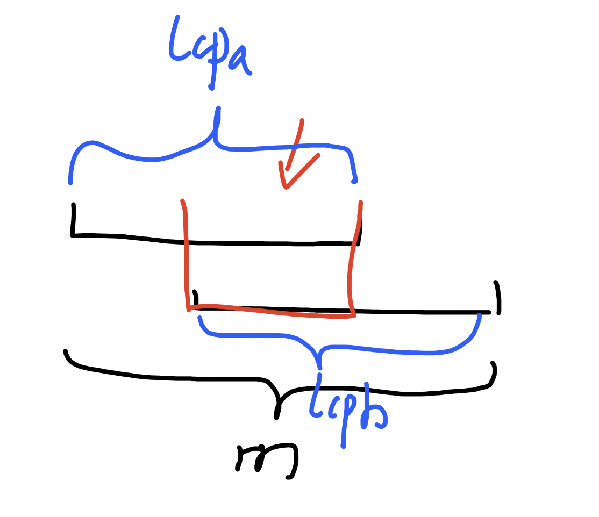

【题解】CF1313E

<!-- MORE -->

## CF1313E

### 题目描述：

给定三个串 $a,b,s$，其中 $a,b$ 长度为 $n$，$s$ 长度为 $m$，求出四元组 $(l1,r1,l2,r2)$ 的个数，满足：

1. $[l1,r1]$ 和 $[l2,r2]$ 的交集非空。

2. $a$ 中位置 $l1$ 到 $r1$ 组成的子串与 $b$ 中位置 $l2$ 到 $r2$ 组成的子串拼起来恰好是 $s$。

$1 \leq n \leq 500000$，$2 \leq m \leq 2n$。

### 题目分析：

如果没有第一个条件，直接 AC 自动机做就好了。

有了第一个条件之后，AC 自动机显然做不了。

考虑一个串肯定是一个前缀和一个后缀拼起来的，那么我们用 $lcpa_i$ 表示 $a_i,a_{i+1},\cdots,a_n$ 和 $s_1,s_2,\cdots,s_n-1$ 的最长公共前缀，$lcpb_i$ 表示 $b_1,b_2,\cdots,b_i$ 和 $s_2,s_3,\cdots,s_n$ 的最长公共前缀。

以上用 `Z函数` 求出即可。

需要保证：
$$
r_1-l_1+1+r_2-l_2+1=m
$$
移一下项，得到：
$$
r2=m-r_1+l_2+l_1-2
$$
因为两区间有交，那么肯定有 $r_1\le l_2 \land l_1\le r_2$，所以 $-r_1+l_2\le0$，即：
$$
l_1 \le r_2\le m+l_1-2
$$
$r_1$ 和 $l_2$ 就不需要管了，只要选择的两个点符合如上条件，便符合题意。

考虑得到 $l_1$ 和 $r_2$ 之后如何求四元组个数，其实就是 $lcpa_{l_1}+lcpb_{r_2}-m+1$，如下图：



那么红色区间中的任何一个点都可以被作为分界点，能组成的四元组个数自然也就是分界点的个数。

那么统计答案从五维变成两维：
$$
\sum_{l_1=1}^{n} \sum_{r_2=l_1}^{\min(n,l_1+m-2)} \max(lcpa_{l_1}+lcpb_{r_2}-m+1,0)
$$
肯定需要降到 $\log$ 层次，但是这个 $\max$ 搞得很难受，也就是说 $lcpa_{l_1}+lcpb_{r_2}-m+1\ge 0$，即 $lcpa_{l_1}\ge m-lcpb_{r_2}-1$。

式子变为：
$$
\sum_{l_1=1}^{n} cnt\times (lcpa_{l_1}-m+1) \sum_{r_2=l_1}^{\min(n,l_1+m-2)} lcpb_{r_2}[ m-lcpb_{r_2}-1\le lcpa_{l_1}]
$$
发现可以用两个树状数组来求值，一个是当前合法区间内 $lcpb_{r_2}$ 出现过得次数，一个是当前合法区间内 $lcpb_{r_2}$ 出现的和。

### 代码：

<details>
  <summary> 点击查看代码 </summary>

```cpp
const int INF=1e9+7;
const int N=2e6+7;

int lcpa[N],lcpb[N];
int za[N],zb[N];
int n,m;
char s[N],a[N],b[N];

void init(){
    char buf[N];
    int cnt=0;
    for (int i=1;i<m;i++) buf[cnt++]=s[i];
    buf[cnt++]='#';
    for (int i=1;i<=n;i++) buf[cnt++]=a[i];
    int l=0,r=0;
    for(int i=1;i<cnt;i++){
        if(i<=r) za[i]=min(za[i-l],r-i);
        while(i+za[i]<cnt&&buf[za[i]]==buf[i+za[i]]) za[i]++;
        if(i+za[i]>r) l=i,r=i+za[i];
    }
    memset(buf,0,sizeof buf);
    cnt=0;
    for (int i=m;i>=2;i--) buf[cnt++]=s[i];
    buf[cnt++]='#';
    for (int i=n;i>=1;i--) buf[cnt++]=b[i];
    l=0,r=0;
    for(int i=1;i<cnt;i++){
        if(i<=r) zb[i]=min(zb[i-l],r-i);
        while(i+zb[i]<cnt&&buf[zb[i]]==buf[i+zb[i]]) zb[i]++;
        if(i+zb[i]>r) l=i,r=i+zb[i];
    }
    for (int i=1;i<=n;i++) lcpa[i]=za[i+m-1];
    for (int i=1;i<=n;i++) lcpb[i]=zb[i+m-1];
    reverse(lcpb+1,lcpb+n+1);
}

struct node{
    int tr[N];
    #define lowbit(x) x&-x
    void add(int x,int k){
        x=max(x,1ll);
        for (;x<N;x+=lowbit(x)) tr[x]+=k;
    }
    int query(int x){
        int res=0;
        for (;x;x-=lowbit(x)) res+=tr[x];
        return res;
    }
}T1,T2;
// T1 用来计个数，T2 用来记 lcpb 的和

signed main(){
    scanf("%lld%lld",&n,&m);
    scanf("%s%s%s",a+1,b+1,s+1);
    init();
    int r2=1,ans=0;
    for (int l1=1;l1<=n;l1++){
        while(r2<=l1+m-2){
            T1.add(m-1-lcpb[r2],1);
            T2.add(m-1-lcpb[r2],lcpb[r2]);
            r2++;
        }
        ans+=(T1.query(lcpa[l1]))*(lcpa[l1]-m+1)+T2.query(lcpa[l1]);
        T1.add(m-1-lcpb[l1],-1);
        T2.add(m-1-lcpb[l1],-lcpb[l1]);
    }
    printf("%lld\n",ans);
    return 0;
}
```
</details>

