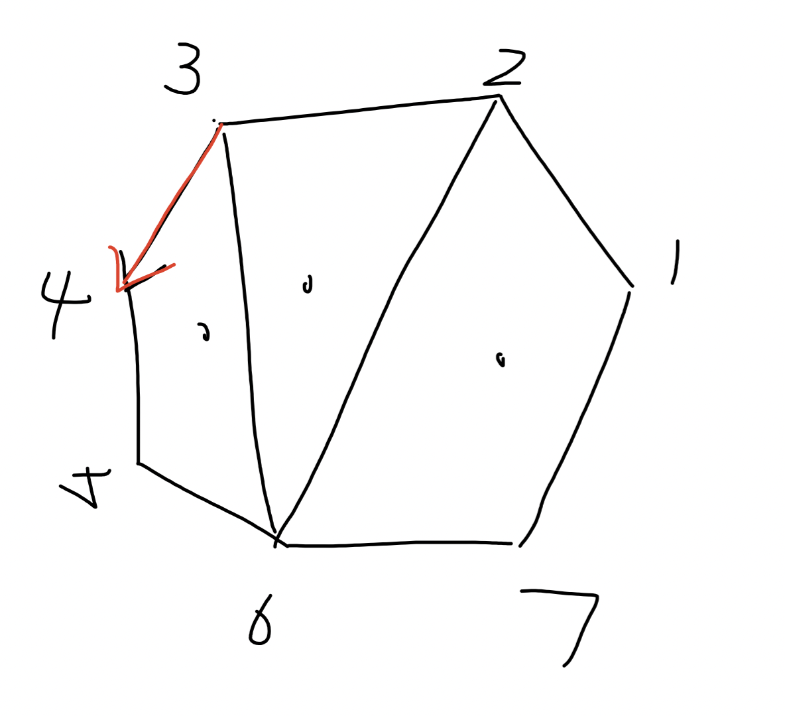

这场给我一种可做但是做不出来的感觉。

<!-- MORE -->

## T1

### 题目描述：

现在有 $𝑛$ 个格子从左到右依次编号为一个排列 $p_1,p_2,⋯,p_n$，以及一个小球，初始在 $1$ 号格子。小球在第$𝑖−1$ 个时刻会沿最短路移动到 $i$，第 $𝑛$ 个时刻停止。

现在你想要在若干格子之间放一些计数器，初始为 $0$，每对相邻格子之间至多放一个。每当小球经过计数器时计数器就会加一。你想要知道如果要所有计数器之和 $\ge k$，那么至少要放多少个计数器。如果不能达成则输出 $−1$。

$n\le 10^6$。

### 题目分析：

间隔区间加的时候差分一下即可，从大到小排序选择即可，如果总的加起来都不够 $k$，输出 $-1$。

### 代码：

<details>
  <summary> 点击查看代码： </summary>


  ```cpp
const int INF=1e9+7;
const int N=1e6+7;

int a[N],n,k;
int pos[N];

bool cmp(int a,int b){
    return a>b;
}

signed main(){
    scanf("%lld%lld",&n,&k);
    for (int i=1;i<=n;i++){
        int x=read();
        pos[x]=i;
    }
    pos[0]=1;
    for (int i=1;i<n;i++){
        int j=i+1;
        int x=pos[i],y=pos[j];
        if (x>y) swap(x,y);
        a[x]++,a[y]--;
    }
    for (int i=1;i<=n-1;i++) a[i]+=a[i-1];
    sort(a+1,a+n,cmp);
    int ans=0,sum=0;
    for (int i=1;i<n;i++){
        sum+=a[i];
        ans++;
        if (sum>=k) break;
    }
    if (sum<k) puts("-1");
    else printf("%lld\n",ans);
    return 0;
}
  ```

</details>


## T2

### 题目描述：


你现在有一个长为 $3𝑛$ 的圆环。圆环上分布着 $3𝑛$ 个点，这些点总共分为 $𝑛$ 组。每个点都会被分到恰好一组里面，且每一组里面恰好 $3$ 个点。

你想要知道，如果在每一组里面选恰好两个点，然后在这两个点间在圆上画一条不经过这一组中没被选中的那个点的圆弧(圆环上的一个区间)，那么有多少种方案使得每对圆弧没有任何相交的部分？

由于显然的原因，答案对 $10^9+7$ 取模。

$n\le 10^6$。

### 题目分析：

考虑先把 $1$ 选了，这个时候用一个数组 $b$ 把所有未被覆盖的位置记录下来，那么剩下的点一定在数组 $b$ 中决策，这个时候，原来环的限制也没了，可以直接 $\text{dp}$，设 $dp_i$ 表示从 $1$ 到 $i$，最多能决策多少组答案。

还可以发现性质，就是选择的两个点，一定是在 $b$ 中相邻的两个点，否则就会穿过 $1$ 选过的位置。

那么用一个 $lst$ 记录上一个出现的位置 $pos$，就可以 $dp_{pos} \to dp_i$。

### 代码：

<details>
  <summary> 点击查看代码： </summary>


  ```cpp
const int INF=1e9+7;
const int N=3e6+7;
const int mod=1e9+7;

int a[N],lst[N],ans=0,n;
int b[N],m;
vector<int> v;
PII f[N];

void add(int &x,int y){
    x+=y;
    if (x>=mod) x-=mod;
}

void solve(int x,int y){
    #define nxt(x) (x==3*n)?1:x+1
    for (int i=1;i<=n;i++) lst[i]=0;
    int m=0;
    for (int i=nxt(x);i!=y;i=nxt(i)) b[++m]=a[i];
    f[0]={1,1};
    for (int i=1;i<=m;i++){
        int pre=lst[b[i]];
        f[i]=f[i-1];
        if (pre){
            if (f[pre-1].fi+1>f[i].fi){
                f[i]=f[pre-1];
                add(f[i].fi,1);
            }
            else if (f[pre-1].fi+1==f[i].fi){
                add(f[i].se,f[pre-1].se);
            }
        }
        lst[b[i]]=i;
    }
    if (f[m].fi==n) add(ans,f[m].se);
}

signed main(){
    scanf("%lld",&n);
    for (int i=1;i<=3*n;i++){
        scanf("%lld",&a[i]);
        if (a[i]==1) v.p_b(i);
    }
    solve(v[1],v[0]);
    solve(v[2],v[1]);
    solve(v[0],v[2]);
    printf("%lld\n",ans);
    return 0;
}
  ```

</details>

## T3

### 题目描述：

现在有 $𝑛$ 个 $\text{pair}$，第 $𝑖$ 个为 $(𝑥𝑖,𝑦𝑖)$，保证 $𝑥_𝑖 \not= 𝑥_𝑗,𝑦_𝑖 \not= 𝑦_𝑗(𝑖\not=𝑗)$。

现在你每次可以选择如下两种操作之一：

1. 找到剩余的 $\text{pair}$ 中 $x$ 最大的。如果其编号为 $𝑖$，则花费 $𝑥_𝑖$ 的代价删除 $(x_i,y_i)$。
2. 找到剩余的 $\text{pair}$ 中 $y$ 最大的。如果其编号为 $𝑖$，则花费 $𝑦_𝑖$ 的代价删除 $(x_i,y_i)$。

你现在想要知道将所有 $𝑛$ 个 $\text{pair}$ 全部删除的最小代价是多少。

### 题目分析：

一看到这种题就想到 $\text{dp}$ 了，本来想的分别按 $x$ 和 $y$ 排序成 $a$ 和 $b$，然后设 $dp_{i,j}$ 表示 $a$ 的前 $i$ 个用 $x$ 删除，$b$ 的前 $j$ 个用 $y$ 删除，但是发现没有什么优化的空间，所以说得换一种思路。

看到 $(x,y)$ 这种形式，考虑把他扔到二维平面上，观察一些性质。

首先按照 $x$ 排序，然后从左往右选，判断用 $x$ 删还是用 $y$ 删。

假设前面所有删除用 $x$ 的所对应的 $y$ 的最大值为 $\text{mx}$，那么如果删除一个新的数，他的 $y$ 比 $\text{mx}$ 小，那么他就不可以通过 $y$ 删除，因为想要删除这个 $y$，肯定要删除前面 $x$ 中的那个 $\text{mx}$，但是删除 $\text{mx}$，有需要先把当前的这个数删掉，因为当前的 $x$ 比前面的大，这样就矛盾了。

所以设 $dp_{i,j}$ 表示前 $i$ 个数已经决策完了，并且当前的删 $x$ 所对应的 $y$ 最大值为 $j$，删除代价的最小值是什么。

但是现在还是 $n^2$ 的复杂度。

观察转移：

1. $j<=y_i$，那么当前点选 $x$ 或者 $y$ 都可以，选 $x$ 就转移到 $dp_{i+1,j}$，选 $y$ 就转移到 $dp_{i+1,y}$。
2. $j>y_i$，那么当前点只能选 $x$，转移到 $dp_{i+1,j}$。

发现上面的两个其实就是一个区间加法，所以把 $f$ 数组扔到线段树上做即可，复杂度为 $O(n\log n)$。

### 代码：

<details>
  <summary> 点击查看代码： </summary>


  ```cpp
const int INF=1e18+7;
const int N=5e5+7;

int n,num[N],cnt;
PII a[N];

namespace SG{
    #define ls(x) x<<1
    #define rs(x) x<<1|1
    struct node{
        int mn,tag;
    }t[(N<<2)+5];
    void pushup(int p){
        t[p].mn=min(t[ls(p)].mn,t[rs(p)].mn);
    }
    void add(int p,int k){
        t[p].mn+=k;
        t[p].tag+=k;
    }
    void pushdown(int p){
        if (!t[p].tag) return;
        add(ls(p),t[p].tag);
        add(rs(p),t[p].tag);
        t[p].tag=0;
    }
    void build(int l,int r,int p){
        t[p].mn=INF,t[p].tag=0;
        if (l==r) return;
        int mid=(l+r)>>1;
        build(l,mid,ls(p)),build(mid+1,r,rs(p));
        pushup(p);
    }
    void add(int ql,int qr,int l,int r,int p,int k){
        if (ql>qr) return;
        if (ql<=l&&qr>=r) return add(p,k),void();
        int mid=(l+r)>>1;pushdown(p);
        if (ql<=mid) add(ql,qr,l,mid,ls(p),k);
        if (qr>mid) add(ql,qr,mid+1,r,rs(p),k);
        pushup(p);
    }
    void modify(int pos,int l,int r,int p,int k){
        if (l==r){
            t[p].mn=min(t[p].mn,k);
            return;
        }
        int mid=(l+r)>>1;pushdown(p);
        if (pos<=mid) modify(pos,l,mid,ls(p),k);
        else modify(pos,mid+1,r,rs(p),k);
        pushup(p);
    }
    int query(int ql,int qr,int l,int r,int p){
        if (ql>qr) return INF;
        if (ql<=l&&qr>=r) return t[p].mn;
        int mid=(l+r)>>1,ans=INF;pushdown(p);
        if (ql<=mid) ans=min(ans,query(ql,qr,l,mid,ls(p)));
        if (qr>mid) ans=min(ans,query(ql,qr,mid+1,r,rs(p)));
        return ans;
    }
}using namespace SG;

signed main(){
    scanf("%lld",&n);
    for (int i=1;i<=n;i++){
        scanf("%lld%lld",&a[i].fi,&a[i].se);
        num[++cnt]=a[i].se;
    }
    sort(num+1,num+cnt+1);
    cnt=unique(num+1,num+cnt+1)-num-1;
    for (int i=1;i<=n;i++){
        a[i].se=lower_bound(num+1,num+cnt+1,a[i].se)-num;
    }
    build(0,cnt,1);modify(0,0,cnt,1,0);
    sort(a+1,a+n+1);
    for (int i=1;i<=n;i++){
        int mn=query(0,a[i].se,0,cnt,1);
        add(0,a[i].se,0,cnt,1,num[a[i].se]);
        modify(a[i].se,0,cnt,1,mn+a[i].fi);
        add(a[i].se+1,cnt,0,cnt,1,a[i].fi);
    }
    printf("%lld\n",t[1].mn);
    return 0;
}
  ```

</details>

## T4

### 题目描述：

现在平面上有 $n$ 个点围成了一个凸包，并且按照逆时针顺序依次标号为 $1,2,3,⋯,n$。

这些点之间总共有 $m$ 条双向边，每条边有一个边权。其中第 $i$ 号点与第 $i+1$ 号点直接一定有边(如果 $i=n$ 则 $n$ 号点与 $1$ 号点之间有边)。所有边保证如果将其画为一条两端点间的直线段则任意两条边在除了端点的地方不交。

现在定义 $flow(s,t)$ 表示如果将边权视作边的容量，从 $s$ 出发到 $t$ 的最大流大小。你需要求出 $\sum\limits_{s<t}flow(s,t)$。

由于答案可能很大，因此对 $10^9+7$ 取模。

$n\le 5\times 10^5$，$m\le 2\times n-3$。

### 题目分析：

首先你可以写个最小割树，能获得 $70$ 分的高分，但是我没学过，所以我打了 $50$ 的暴力。

考虑在凸包上的最短的一条边，一定属于割集，证明如下。

> 因为这个图的性质，我们完全可以把他变成一个对偶图，那么选的最短路如果经过最短边所在的面，那么一定会从最小的这条边出去，所以最小的边一定属于割集。

考虑每次删掉最小的那条边，然后给这个面的剩下的边加上当前的权值，就相当于如果选了这个面的任意一个点，一定是从这个位置出去的。那次去删这个最小的边，直到删成树为止，那么 $flow(u,v)$ 就变成 $u$ 和 $v$ 路径上的最小值了，这个可以直接用并查集做。

现在问题变成了，怎么去选一个面，这里提供一种非常高妙的做法（也是题目里钦定 $1\sim n$ 按逆时针排序的原因），每个点按照他出边端点的大小排序，然后从小到大的去记录他的 $to$ 是什么。

```cpp
for (int i=1;i<=m;i++){
      int u=read(),v=read(),w=read();
      e[++tot]={u,v,w};
      E[u].p_b(tot);
      e[++tot]={v,u,w};
      E[v].p_b(tot);
  }
  for (int i=1;i<=n;i++){
      sort(E[i].begin(),E[i].end(),cmp);
      for (int j=0;j<E[i].size();j++){
          int nxt=(j+1)%((int)E[i].size());
          to[E[i][j]]=E[i][nxt]^1;
      }
  }
```

我们删边的时候，从凸包上开始删，并且保证 $u=v-1$，这样每次的 $to$ 不是比他大的第一个数，就是最小的数，可以自己画一个图手动模拟一下，比如说从下图的 $(3,4)$ 开始。



这样的话每条边只会被经过 $2$ 次，复杂度是线性的。

总复杂度为 $O(n\log n)$。

### 代码：

<details>
  <summary> 点击查看代码： </summary>


  ```cpp
const int INF=1e9+7;
const int N=1e5+7;
const int mod=1e9+7;

int n,m,tot=1,t[N],cnt;
int to[N],vis[N];
int fa[N],sz[N];
vector<int> E[N];
struct node{
    int u,v;
    LL w;
}e[N];

int find(int x){
    if (x==fa[x]) return x;
    return fa[x]=find(fa[x]);
}

void add(int &a,int b){
    a+=b;
    if (a>=mod) a-=mod;
}

bool cmp(int a,int b){
    return e[a].v<e[b].v;
}

bool cmp1(int a,int b){
    return e[a].w>e[b].w;
}

signed main(){
    scanf("%d%d",&n,&m);
    for (int i=1;i<=m;i++){
        int u=read(),v=read(),w=read();
        e[++tot]={u,v,w};
        E[u].p_b(tot);
        e[++tot]={v,u,w};
        E[v].p_b(tot);
    }
    for (int i=1;i<=n;i++){
        sort(E[i].begin(),E[i].end(),cmp);
        for (int j=0;j<E[i].size();j++){
            int nxt=(j+1)%((int)E[i].size());
            to[E[i][j]]=E[i][nxt]^1;
        }
    }
    priority_queue<PII> q;
    for (int i=2;i<=tot;i++){
        if (e[i].v-e[i].u==1||e[i].v-e[i].u==1-n) q.push({-e[i].w,i}),vis[i]=1;
    }
    while(!q.empty()){
        int u=q.top().se;q.pop();
        if (vis[u]==2) continue;
        vis[u]=vis[u^1]=2;
        int now=to[u];
        while(now!=u){
            vis[now]++;
            vis[now^1]++;
            e[now].w+=e[u].w;
            e[now^1].w+=e[u].w;
            if (vis[now]==2) t[++cnt]=now;
            if (vis[now]==1) q.push({-e[now].w,now^1});
            now=to[now];
        }
    }
    sort(t+1,t+cnt+1,cmp1);
    for (int i=1;i<=n;i++) fa[i]=i,sz[i]=1;
    int ans=0;
    for (int i=1;i<=cnt;i++){
        int x=find(e[t[i]].u),y=find(e[t[i]].v);
        add(ans,1ll*sz[x]*sz[y]%mod*e[t[i]].w%mod);
        fa[x]=y;
        sz[y]+=sz[x];
    }
    printf("%d\n",ans);
    return 0;
}
  ```

</details>

