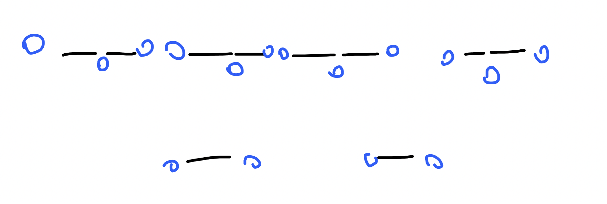

一些典型的套路或者是分析性质，不知道的套路还有好多/kk

<!-- MORE -->

## P3688

### 题目描述：

给出一个长度为 $n$ 的数组 $A$，初始值都为 $0$，接下来进行 $m$ 次操作，操作有两种：

* $1\ x$，表示将 $A_x$  变成 $(A_x + 1) \bmod 2$。
* $2\ l\ r$，表示询问 $(\sum_{i=l}^r A_i) \bmod 2$。

可怜还是发现这题可以用树状数组做。当时非常 young 的她写了如下的算法：


如果你对树状数组比较熟悉，不难发现可怜把树状数组写错了：**$\text{Add}$ 和 $\text{Find}$ 中 $x$  变化的方向反了**。因此这个程序在最终测试时华丽的爆 $0$ 了。

现在可怜给出了一个长度为 $n$ 的数组 $A$，初始为 $0$，接下来进行了 $m$ 次操作：

* $1\ l\ r$，表示在区间 $[l, r]$ 中等概率选取一个 $x$ 并执行 $\text{Add}(x)$ 。

* $2\ l\ r$，表示询问执行 $\text{Query}(l, r)$ 得到的结果是正确的概率是多少。


对于 $100\%$ 的数据，保证 $1\leq l\leq r\leq n$。

### 题目分析：

把树状数组写反相当于原先求得是前缀，现在变成了后缀。

画个图就可以发现原先求得是 $[l,r]$，现在求的是 $[l-1,r-1]$，那么正确就意味着 $a_{l-1}=a_r$，现在题目转化为每次在一个区间等概率修改某一个点，求 $a_{l-1}=a_r$ 的概率。

第一想法是直接给每个点乘上修改的概率和不改的概率，查询时求和即可。

但是如果修改的区间是 $[1,2]$，查询的是 $l-1=1,r=2$，那么这个时候直接求和发现答案是 $\frac{1}{4}$，但是正确答案为 $0$，因为 $1$ 和 $2$ 不可能被同时修改。

换一种思路，直接记录二元环 $i,j$，表示 $i,j$ 相等的概率。

考虑如果修改一个区间，会对整个矩形造成什么样的影响，会发现 $[1,l-1]$ 和 $[l,r]$ 组合起来的二元组都有 $\frac{1}{len}$ 的概率会被改，$[l,r]$ 和 $[r+1,n]$ 组合起来的二元组也会有 $\frac{1}{len}$ 被修改，$[l,r]$ 和 $[l,r]$ 组合起来的二元组有 $\frac{2}{len}$ 的概率会被修改。

现在其实就是对一个二维的矩阵做区间修改，单点查询操作，直接上树套树即可，因为只会修改，不会撤销，所以直接搞一个标记永久化，让代码更好写并且复杂度更优。

**注意**：发现可怜的代码里有一个 $x=0,return\ 0$ 的操作，手模一下可以得到，当 $l=1$ 时，要求的是他的前缀和和后缀和是否相等，把这个答案直接放在 $0$ 这一维上即可。

### 代码：

听说还有 CDQ 做法，我看了眼感觉很神仙/kk

<details>
<summary> 点击查看代码 </summary>

```cpp
const int INF=1e9+7;
const int N=1e5+7;
const int mod=998244353;

int n,q,rt[N<<2],cnt;
struct node{
    int ls,rs,val;
}tr[N*400];

LL qmi(LL a,LL k){
    LL res=1;
    for (;k;k>>=1,a=a*a%mod) if (k&1) res=res*a%mod;
    return res;
}
LL mul(LL q,LL p){
    LL res=q*p%mod;
    res=(res+(1-p+mod)%mod*(1-q+mod)%mod+mod)%mod;
    return (res+mod)%mod;
}

void changey(int ql,int qr,int l,int r,int &k,LL p){
    if (!k){k=++cnt;tr[k].val=1;}
    if (ql<=l&&qr>=r){
        tr[k].val=mul(tr[k].val,p);
        return;
    }
    int mid=(l+r)>>1;
    if (ql<=mid) changey(ql,qr,l,mid,tr[k].ls,p);
    if (qr>mid) changey(ql,qr,mid+1,r,tr[k].rs,p);
}

void changex(int lx,int rx,int l,int r,int k,int ly,int ry,LL p){
    if (lx<=l&&rx>=r) {changey(ly,ry,1,n,rt[k],p);return;};
    int mid=(l+r)>>1;
    if (lx<=mid) changex(lx,rx,l,mid,ls(k),ly,ry,p);
    if (rx>mid) changex(lx,rx,mid+1,r,rs(k),ly,ry,p);
}

LL queryy(int pos,int l,int r,int k){
    if (!k) return 1ll;
    if (l==r) return tr[k].val;
    int mid=(l+r)>>1;
    if (pos<=mid) return mul(tr[k].val,queryy(pos,l,mid,tr[k].ls));
    else return mul(tr[k].val,queryy(pos,mid+1,r,tr[k].rs));
}

LL queryx(int posx,int posy,int l,int r,int k){
    if (l==r) return queryy(posy,1,n,rt[k]);
    int mid=(l+r)>>1;
    if (posx<=mid) return mul(queryy(posy,1,n,rt[k]),queryx(posx,posy,l,mid,ls(k)));
    else return mul(queryy(posy,1,n,rt[k]),queryx(posx,posy,mid+1,r,rs(k)));
}

signed main(){
    // a_{l-1} 和 a_r 是否相同
    scanf("%d%d",&n,&q);
    LL len;int op,l,r;
    while(q--){
        op=read(),l=read(),r=read();
        if (op==1){
            len=qmi(r-l+1,mod-2);
            if (l>1) changex(1,l-1,0,n,1,l,r,(1-len+mod)%mod),changex(0,0,0,n,1,1,l-1,0ll);
            if (r<n) changex(l,r,0,n,1,r+1,n,(1-len+mod)%mod),changex(0,0,0,n,1,r+1,n,0ll);
            changex(l,r,0,n,1,l,r,(1-2ll*len+mod)%mod);changex(0,0,0,n,1,l,r,len);
        }
        else printf("%lld\n",queryx(l-1,r,0,n,1));
    }
    return 0;
}
```
</details>

## CF840C

### 题目描述

给定一个序列 $a(a_i\le 10^9)$，长度为 $n(n\le 300)$。

试求有多少 $1$ 到 $n$ 的排列 $p_i$，满足对于任意的 $2\le i\le n$ 有 $a_{p_{i-1}}\times a_{p_i}$ 不为完全平方数，答案对 $10^9+7$ 取模。

### 题目分析：

对于一个数 $a$，显然可以把他分解成 $n^2\times q$，对于一个数 $b$，如果 $a\times b$ 为完全平方数，当且仅当 $n^2\times q=m^2 \times p(p=q)$，也就是说，当我们把他们带平方幂的因子去掉后，剩下的数相同，则 $a \times b$ 为完全平方数。

现在问题转化为给定一些数，求两两相同的数不能相邻所组成数列的方案数。

发现和之前做过的 CF258D[题解](https://blog.taozhiming.top/dp-2600/#CF258D) 很像，但其实差别很大，因为 CF258D 只有 $3$ 中编号，但现在我们有 $n$ 种，不可能开出来 $n$ 维。

现在换一种思路，枚举每一个数，并且判断把他加入后对整个序列的影响，第一想法是记录相邻两数一样的数对个数，设 $dp_{i,j}$ 表示已经加入了 $i$ 个数，相邻两个数一样的数对个数为 $j$ 的方案数。

考虑插入一个数会有 $4$ 中情况：

1. 插入的数和两边的数相同，并且两边的数本来也相同。
2. 插入的数和一边的数相同，另一边不同。
3. 插入的数和两边的数不同，但是两边的数原来相同。
4. 插入的数和两边的数不同，并且两边的数本来也不同。

发现光记录相邻相同的数对个数还不够，还需要记录一个和当前点一样的相邻相等的数对个数。

设 $dp_{i,j,k}$ 表示已经加入了 $i$ 个数，相邻两个数一样的数对个数为 $j$，和当前插入的数一样的相邻相等的数对个数的方案。

**以下 $x$ 表示前面有多少个数和插入的数相同**。

对于**第一种**和**第二种**情况，都会对 $j$ 和 $k$ 产生 $+1$ 的贡献，考虑一起处理。



上图中蓝色点即为可以插入的地方，观察规律可以发现转移如下：
$$
dp[i][j][k]\times (x+x-k)\to dp[i+1][j+1][k+1]
$$
**第三种**情况为：
$$
dp[i][j][k]\times(j-k)\to dp[i+1][j-1][k]
$$
**第四种**情况，不能放在一二情况中的位置，也不能放在第三种情况的位置，转移即为：
$$
dp[i][j][k]\times(i-(x+x-k)-(j-k))\to dp[i+1][j][k]
$$
**注意**：

1. 可以发现相同的数一定一起转移更加方便，所以转移之前先把处理出来的数排序。
2. 要注意当加入的数从一个相同的区间转到另一个相同的区间，那么 $k$ 这一维的答案都要转移到 $0$ 上去。

### 代码：

<details>
<summary> 点击查看代码 </summary>

```cpp
const int INF=1e9+7;
const int N=307;
const int mod=1e9+7;

int dp[2][N][N];
int n,a[N],s[N];

signed main(){
    scanf("%lld",&n);
    for (int i=1;i<=n;i++){
        scanf("%lld",&a[i]);
        int x=a[i];
        for (int j=2;j*j<=a[i];j++)
            while(x%(j*j)==0) x/=(j*j);
        a[i]=x;
    }
    sort(a+1,a+n+1);
    for (int i=1;i<=n;i++){
        int j=i;
        while(j<=n&&a[j+1]==a[j]) j++,s[j]=s[j-1]+1;
        i=j;
    }
    int now=0;
    dp[0][0][0]=1;
    for (int i=1;i<=n;i++){
        int lst=now^1,x=s[i];
        if (a[i]!=a[i-1]){
            x=s[i-1];
            for (int j=0;j<=i;j++){
                for (int k=1;k<=x;k++){
                    dp[lst][j][0]=(dp[lst][j][0]+dp[lst][j][k])%mod;
                    dp[lst][j][k]=0;
                }
            }
            x=0;
        }
        for (int j=0;j<=i;j++){
            for (int k=0;k<=min(j,x);k++){
                if (j&&k) dp[now][j][k]=(dp[now][j][k]+dp[lst][j-1][k-1]*(x+x-(k-1))%mod)%mod;
                dp[now][j][k]=(dp[now][j][k]+dp[lst][j+1][k]*(j+1-k)%mod)%mod;
                dp[now][j][k]=(dp[now][j][k]+dp[lst][j][k]*(i-(x+x-k)-(j-k))%mod)%mod;
            }
        }
        now^=1;
        memset(dp[now],0,sizeof dp[now]);
    }
    printf("%lld\n",dp[now^1][0][0]);
    return 0;
}
```
</details>


## loj6043

### 题目描述：

在离跳蚤国很远的地方有一个蛐蛐国，最近蛐蛐国选出了一位新的领导人。

这位领导人上任之后做的第一件事，就是在蛐蛐国和它的一个邻国 —— 蝈蝈国之间修一堵围墙。

围墙可以看成是一个长度为 $n$ 的括号序列，与此同时还有一个长度为 $n$ 的排列 $P$，一个围墙被称为稳的，当且仅当：

1. 这个括号序列是合法的；
2. 构造一张 $n$ 个点的图，当且仅当第 $i$ 个位置是左括号时，点 $i$ 向点 $P_i$ 连边，最后形成的图必须满足每个点的度数均为一。

保证对于任意 $i$ 有 $i \neq P_i$。

一个括号序列合法的定义如下：

1. 空序列是合法的；
2. 如果 $A$ 是合法的，那么 $\texttt{(}A\texttt{)}$ 也是合法的；
3. 如果 $A$ 和 $B$ 都是合法的，那么 $AB$ 也是合法的。

例如 $\texttt{()()((()()))}$ 是合法的，而 $\texttt{())(()}$ 不是。

现在蛐蛐国的领导人想知道一种合法的修墙方案。

### 题目分析：

上来想到直接暴力，代码如下：

<details>
<summary> 点击查看代码 </summary>

```cpp
const int INF=1e9+7;
const int N=100+7;

int n,p[N],deg[N],top;
char s[N];
bool flag=0;

void dfs(int now){
    if (flag) return;
    if (top>n-now+1) return;
    if (now==n+1){
        flag=1;
        for (int i=1;i<=n;i++) cout<<s[i];
        return;
    }
    if (!deg[p[now]]&&!deg[now]){
        ++top,s[now]='(';
        deg[p[now]]++;deg[now]++;
        dfs(now+1);
        top--;deg[p[now]]--;deg[now]--;
    }
    // 以上是加入左括号
    if (top){
        top--;s[now]=')';
        dfs(now+1);
        ++top;
    }
    // 以上是加入右括号
}

signed main(){
    scanf("%d",&n);
    for (int i=1;i<=n;i++) scanf("%d",&p[i]);
    dfs(1);
    return 0;
}
```
</details>

但发现只能拿 $81$ 的高分，发现没办法在减枝了，需要换一个方向，考虑从排列上可不可以得到些什么。

因为我们是连边，那么最后形成的一定是一堆环，发现如果环长为基数，那么连括号序都不会出现。如果环长为偶数，那么只要固定好一个点，其他的点便全都固定了。

比如，$2\ 3\ 4\ 1$ 这样的环，只能构造出 $()()$ 这样的括号序，其他的都是不合法的。

考虑如果全部都是二元环（二元环指 $i$ 连向 $j$，$j$ 连向 $i$），那么我们起码需要固定一个，复杂度即为 $2^{n/2}$。

发现二元环完全可以自己先匹配完，那么可以把所有的二元环都去掉，那么现在最小的环即为 $4$，复杂度也降为 $2^{n/4}$，可过。

### 代码：

<details>
<summary> 点击查看代码 </summary>

```cpp
const int INF=1e9+7;
const int N=107;

int n;
int pre[N],nxt[N];
bool vis[N],flag=0;
char s[N];

void dfs(int now,int res){
    if (res<0||flag) return;
    if (now==n+1){
        if (res!=0) return;
        flag=1;
        for (int i=1;i<=n;i++) cout<<s[i];
        return;
    }
    if (vis[now]){
        if (s[now]=='(') dfs(now+1,res+1);
        else dfs(now+1,res-1);
        return;
    }
    if (!vis[pre[now]]&&!vis[nxt[now]]){
        vis[now]=1;s[now]='(';
        dfs(now+1,res+1);
        s[now]=')';
        dfs(now+1,res-1);
        vis[now]=0;
    }
    if (vis[nxt[now]]&&vis[pre[now]]&&s[nxt[now]]!=s[pre[now]]) return;
    if (vis[pre[now]]){
        vis[now]=1;
        if (s[pre[now]]=='('){
            s[now]=')';
            dfs(now+1,res-1);
        }
        else s[now]='(',dfs(now+1,res+1);
        vis[now]=0;
    }
    else if (vis[nxt[now]]){
        vis[now]=1;
        if (s[nxt[now]]=='('){
            s[now]=')';
            dfs(now+1,res-1);
        }
        else s[now]='(',dfs(now+1,res+1);
        vis[now]=0;
    }
}

signed main(){
    scanf("%d",&n);
    for (int i=1;i<=n;i++){
        scanf("%d",&nxt[i]);
        pre[nxt[i]]=i;
    }
    for (int i=1;i<=n;i++){
        if (nxt[nxt[i]]==i){
            if (i>nxt[i]) s[i]=')',s[nxt[i]]='(';
            else s[i]='(',s[nxt[i]]=')';
            vis[i]=vis[nxt[i]]=1;
        }
    }
    dfs(1,0);
    return 0;
}
```
</details>


## arc165F

### 题目描述：

给定 $n$ 和一个长度为 $2n$ 的序列 $a$，满足 $[1,n]$ 每个数恰好出现两次。

每一次操作可以交换相邻的两个数，询问最少多少次操作可以使得序列 $a$ 满足 $\forall i\in[1,n]\ a_{2\times i}=a_{2\times i+1}$。

在保证为最小操作次数的前提下，输出所有可以得到序列中字典序最小的那一个。

对于 $100\%$ 的数据，满足：$1≤n≤2×10^5$。

### 题目分析：

先不考虑字典序最小，考虑操作数最小怎么得到。

若只有两个数，那么可能出现的情况只有两种：$1221$ 和 $1212$。

显然第一个变成 $1122$ 和 $2211$ 的操作数最小，第二个变成 $1122$ 的操作数最小。

扩展一下，对于一个数 $i$，第一次出现的位置记为 $l_i$，第二次出现的位置记为 $r_i$。

那么对于任意的 $i,j$，满足 $l_i<l_j$ 并且 $r_i<r_j$，那么就让 $i$ 向 $j$ 连边，最后求一个最小拓扑序即可。

发现边的个数是 $n^2$ 的，考虑怎么优化建图：

- 方法一：

  可以按 $l_i$ 从大到小排序，他的连边一定是连向一个后缀，所以线段树优化建图即可，但是还有一个小问题就是每次都会加入一个数 $r$，所以需要持久化，防止之前连过来的边连向 $r$，复杂度 $O(nlog^2n)$。

- 方法二：

  如果只有一维，即只有 $l_i<l_j$，可以直接排序后前缀优化建图。

  但是现在有两维，分治把第一维给去掉，这样就可以 $O(nlogn)$ 建图并且求解了。

### 代码：

- 方法一：
  <details>
  <summary> 点击查看代码 </summary>

  ```cpp
  const int INF=1e9+7;
  const int N=5e5+7;
  
  int n,a[N],L[N],R[N],rpos[N],deg[N*30],tot,rt;
  vector<int> G[N*30];
  
  struct node{
      int ls,rs;
  }tr[N*30];
  
  void add_edge(int u,int v){
      if (u&&v){
          G[u].p_b(v);
          deg[v]++;
      }
  }
  
  void add(int ql,int qr,int l,int r,int id,int p){
      if (!p) return;
      if (ql<=l&&qr>=r) {add_edge(id,p);return;}
      int mid=(l+r)>>1;
      if (ql<=mid) add(ql,qr,l,mid,id,ls(p));
      if (qr>mid) add(ql,qr,mid+1,r,id,rs(p));
  }
  
  void modify(int pos,int l,int r,int id,int pre,int &p){
      p=++tot;tr[p]=tr[pre];
      if (l==r) {add_edge(p,id);return;}
      int mid=(l+r)>>1;
      if (pos<=mid) modify(pos,l,mid,id,ls(pre),ls(p));
      else modify(pos,mid+1,r,id,rs(pre),rs(p));
      add_edge(p,ls(p));add_edge(p,rs(p));
  }
  
  void topo(){
      queue<int> q1;
      priority_queue<int> q2;
      for (int i=1;i<=tot;i++){
          if (!deg[i]){
              if (i<=n) q2.push(-i);
              else q1.push(i);
          }
      }
      while((!q1.empty())||(!q2.empty())){
          int u;
          if (q1.empty()) u=-q2.top(),q2.pop();
          else u=q1.front(),q1.pop();
          if (u<=n) printf("%d %d ",u,u);
          for (auto v:G[u]){
              deg[v]--;
              if (!deg[v]){
                  if (v<=n) q2.push(-v);
                  else q1.push(v);
              }
          }
      }
  }
  
  signed main(){
      scanf("%d",&n);tot=rt=n+1;
      for (int i=1;i<=n*2;i++){
          int x=read();a[i]=x;
          if (!L[x]) L[x]=i;
          else R[x]=i;
      }
      for (int i=1;i<=n;i++) rpos[L[i]]=R[i];
      for (int i=(n<<1);i>=1;i--){
          if (!rpos[i]) continue;
          add(rpos[i],n<<1,1,n<<1,a[i],rt);//向后面 R[a[i]] 大的点连边比
          modify(rpos[i],1,n<<1,a[i],rt,rt);//把 R[a[i]] 插入到树中
      }
      topo();
      return 0;
  }
  ```
  <\details>

- 方法二：
  <details>
  <summary> 点击查看代码 </summary>

  ```cpp
  const int INF=1e9+7;
  const int N=4e5+7;
  
  int pos1[N],pos2[N],deg[N*50];
  int n,a[N],L[N],R[N],tot,b[N];
  vector<int> G[N*50];
  
  bool cmp(int a,int b){
      return L[a]<L[b];
  }
  
  void add(int u,int v){
      G[u].p_b(v);
      deg[v]++;
  }
  
  void solve(int l,int r){
      if (l==r) return;
      int mid=(l+r)>>1;
      solve(l,mid);solve(mid+1,r);
      int posl=l,posr=mid+1;
      for (int i=l;i<=mid;i++){
          ++tot;pos1[i]=tot;add(a[i],pos1[i]);
          if (i!=l) add(pos1[i-1],pos1[i]);
      }
      for (int i=r;i>mid;i--){
          ++tot;pos2[i]=tot;add(pos2[i],a[i]);
          if (i!=r) add(pos2[i],pos2[i+1]);
      }
      int cnt=l-1;
      while(posl<=mid&&posr<=r){
          if (R[a[posl]]<R[a[posr]]) add(pos1[posl],pos2[posr]),b[++cnt]=a[posl],posl++;
          else b[++cnt]=a[posr],posr++;
      }
      while(posl<=mid) b[++cnt]=a[posl],posl++;
      while(posr<=r) add(pos1[mid],pos2[posr]),b[++cnt]=a[posr],posr++;
      for (int i=l;i<=r;i++) a[i]=b[i];
  }
  
  void topo(){
      queue<int> q1;
      priority_queue<int> q2;
      for (int i=1;i<=tot;i++){
          if (!deg[i]){
              if (i<=n) q2.push(-i);
              else q1.push(i);
          }
      }
      while((!q1.empty())||(!q2.empty())){
          int u;
          if (q1.empty()) u=-q2.top(),q2.pop();
          else u=q1.front(),q1.pop();
          if (u<=n) printf("%d %d ",u,u);
          for (auto v:G[u]){
              deg[v]--;
              if (!deg[v]){
                  if (v<=n) q2.push(-v);
                  else q1.push(v);
              }
          }
      }
  }
  
  signed main(){
      scanf("%d",&n);
      for (int i=1;i<=2*n;i++){
          int x=read();
          if (!L[x]) L[x]=i;
          else R[x]=i;
      }
      for (int i=1;i<=n;i++) a[i]=i;
      sort(a+1,a+n+1,cmp);
      tot=n;
      solve(1,n);
      topo();
      return 0;
  }
  ```
  </details>

## P4308

### 题目描述

有向图 $G$ 有 $n$ 个顶点 $1,2,...,n$，点 $i$ 的权值为 $w_i$。现在有一只蚂蚁，从给定的起点 $v_0$ 出发，沿着图 $G$ 的边爬行。开始时，它的体力为 $1$。每爬过一条

边，它的体力都会下降为原来的 $ρ$ 倍，其中 $ρ$ 是一个给定的小于 $1$ 的正常数。而蚂蚁爬到某个顶点时的幸福度，是它当时的体力与该点权值的乘积。 

我们把蚂蚁在爬行路径上幸福度的总和记为 $H$。很显然，对于不同的爬行路径，$H$ 的值也可能不同。小 $Z$ 对 $H$ 值的最大可能值很感兴趣，你能帮助他计算吗？注意，蚂蚁爬行的路径长度可能是无穷的。

对于 $100\%$ 的数据，$n ≤ 100， m ≤ 1000， ρ ≤ 1-10^{-6}， \forall i \ w_i ≤ 100$。

### 题目分析：

第一想法是考虑设 $dp_{i,j}$ 表示现在在第 $i$ 个点，已经经过了 $j$ 个点，但是显然复杂度很不对，考虑能不能把第二维去掉。

考虑如果没有环，那么我们每次用松弛只更新一步，这样的话就可以计算 $dis$ 了，并且经过了几个点也可以直接通过枚举的次数得出。

有环的话肯定是一直走环，或者一直走路径。

不会出现走两次环再出去的情况，因为决定走环，就意味着走环一定比走出去更优秀，既然乘的常数都一样，那肯定选更优秀的走下去。

思考怎么求一个环一直走下去能得到的权值，假如环长为 $n$，那么走一圈环的价值就是 $S=a_1+a_2\times p+..+a_n\times p^{n-1}$，一直走下去的权值为 $S+S\times p^n+S\times p^{2\times n}+...$，用等比数列求出来这个式子的值为 $\frac{S}{1-p^n}$，如果不是一开始就绕圈，乘上 $p^x$ 即可。

复杂度为 $O(n^2m)$。

### 代码：

<details>
<summary> 点击查看代码 </summary>

```cpp
const int INF=1e9+7;
const int N=1e4+7;

int n,m,s;
double dis[N],diss[N],w[N],cir[N],p;
vector<int> G[N];

double calc(int x){
    for (int i=1;i<=n;i++) dis[i]=-INF;
    dis[x]=w[x];
    double tmp=p,ans=0;
    for (int _=1;_<=100;_++){
        for (int i=1;i<=n;i++) diss[i]=dis[i];
        for (int u=1;u<=n;u++){
            for (auto v:G[u]){
                diss[v]=max(diss[v],dis[u]+w[v]*tmp);
            }
        }
        for (int i=1;i<=n;i++) dis[i]=diss[i];
        ans=max(ans,(dis[x]-w[x]*tmp)/(1.0-tmp));
        tmp=tmp*p;
    }
    return ans;
}

signed main(){
    scanf("%d%d",&n,&m);
    for (int i=1;i<=n;i++) scanf("%lf",&w[i]);
    scanf("%d%lf",&s,&p);
    for (int i=1;i<=m;i++){
        int u=read(),v=read();
        G[u].p_b(v);
    }
    for (int i=1;i<=n;i++) cir[i]=calc(i);
    for (int i=1;i<=n;i++) dis[i]=-INF;
    dis[s]=w[s];double tmp=p,ans=0;
    for (int _=1;_<=100;_++){
        for (int i=1;i<=n;i++) diss[i]=dis[i];
        for (int u=1;u<=n;u++){
            for (auto v:G[u]){
                diss[v]=max(diss[v],dis[u]+w[v]*tmp);
            }
        }
        for (int i=1;i<=n;i++) dis[i]=diss[i];
        for (int i=1;i<=n;i++) ans=max(ans,dis[i]-w[i]*tmp+cir[i]*tmp);
        tmp=tmp*p;
    }
    printf("%.1f",ans);
    return 0;
}
```
</details>

## P4456

### 题目描述：

我们称一个仅由 $0、1$ 构成的序列为“交错序列“，当且仅当序列中没有相邻的 $1$ (可以有相邻的 $0$ )。例如， $000,001,101$ ，都是交错序列，而 $110$ 则不是。

对于一个长度为 $n$ 的交错序列，统计其中 $0$ 和 $1$ 出现的次数，分别记为 $x$ 和 $y$。给定参数 $a、b$，定义一个交错序列的特征值为 $x^ay^b$。注意这里规定任何整数的 $0$ 次幂都等于$1$ (包括 $0^0=1$ )。

显然长度为 $n$ 的交错序列可能有多个。我们想要知道，所有长度为 $n$ 的交错序列的特征值的和，除以 $m$ 的余数。($m$ 是一个给定的质数)

例如，全部长度为3 的交错串为：$000、001、010、100、101$。当 $a=1,b=2$ 时，可计算:$3^1\times0^2+2^1\times1^2+2^1\times1^2+2^1\times1^2+1^1\times2^2=10$、

对于 $100\%$ 的数据，$1\le n\le 10000000$，$0\le a,b\le 45$，$m<100000000$。

### 题目分析：

**做法一**（错解，但是能过）：

看到题的第一眼是用组合数做，假设现在已经全是 $0$，那么需要的只是在空之间插入一些 $1$，假设现在有 $x$ 个 $1$，那么答案就是 $\binom{n-x+1}{x}$，发现 $n\le 1e7$，很可做。

$O(n)$ 预处理出来组合数，然后发现还需要求 $x^ay^b$，这个东西如果用快速幂求得话，会超时，所以要预处理出来，设 $f(x)=x^a$，其中 $a$ 为常数，且 $a=b\times c$，则 $f(x)=f(b)\times f(c)$，那么可以用个线性筛直接筛出来（这个东西我是真的没有想到，可以这么预处理，感觉**很有用**）。

**注意**错误的原因是 $O(n)$ 预处理组合数的时候，要求一个数的逆元，但是如果 $m\le n$ 那么有些数是没有逆元的，但是这题的数据竟然没有一个 $m\le n$，可能出题人想放这种做法过。

**做法二**：

第一想法是设 $dp_{i,0/1}$ 表示已经填了 $i$ 个数，最后一个是 $0/1$ 的答案，但是这样只能找出方案数，并不可以乘上题目中给的系数，思考加一维，如果加的是 $1$ 的个数，发现空间爆了，时间也爆了，就算加上滚动数组还是寄。

考虑观察转移系数：
$$
x^ay^b=(n-y)^ay^b=\sum\limits_{i=0}^{a}\binom{a}{i}n^i(-y)^{a-i}\times y^b=\sum\limits_{i=0}^{a}\binom{a}{i}n^i(-1)^{a-i}\times y^{a+b-i}
$$
发现只有 $y$ 是个变量，其实的都是常量，所以说只要求出来当 $i$ 固定时，对于每一个不同的 $y$，他的 $a+b-i$ 次方的和，那么设 $dp_{i,j,0/1}$ 表示已经填了 $i$ 个点，所有方案的 $y^j$ 求和的结果。

插入一个 $0$ 的转移显然：
$$
dp[i-1][j][0/1]\to dp[i][j][0]
$$
插入一个 $1$，会产生 $(y+1)^j$ 的贡献，二项式定理展开：$\sum_{k=0}^{j}\binom{j}{k}y^k$。

那么转移如下：
$$
\sum_{k=0}^{j}\binom{j}{k}dp[i-1][k][0]\to dp[i][j][1]
$$
注意到复杂度为 $O(n\times (a+b)^2)$，不能通过，但是发现转移的形式可以看成一个矩阵的形式，矩阵快速幂转移即可，复杂度为 $O((a+b)^3\times \log n)$。

构造矩阵有一个小技巧就是转移矩阵的 $(i,j)$ 处，可以看成是 $dp_i$ 转移到 $dp_j$ 的转移系数，根据这个构造就简单多了。

### 代码：

做法一：

<details>
<summary> 点击查看代码 </summary>

```cpp
const int INF=1e9+7;
const int N=1e7+7;

int fac[N],ifac[N],mod;
int n,a,b,pri[N],f[N],g[N],cnt;
bool chk[N];

int qmi(int a,int k){
    int res=1;
    for (;k;k>>=1,a=a*a%mod) if (k&1) res=res*a%mod;
    return res;
}

int C(int n,int m){
    if (n<m) return 0;
    if (!m) return 1;
    return fac[n]*ifac[m]%mod*ifac[n-m]%mod;
}

void init(){
    fac[0]=1;
    for (int i=1;i<=n;i++) fac[i]=fac[i-1]*i%mod;
    ifac[n]=qmi(fac[n],mod-2);
    for (int i=n-1;i>=0;i--) ifac[i]=ifac[i+1]*(i+1)%mod;
    if (a==0) f[0]=1;
    if (b==0) g[0]=1;
    f[1]=g[1]=1;
    for (int i=2;i<=n;i++){
        if (!chk[i]){
            f[i]=qmi(i,a)%mod;
            g[i]=qmi(i,b)%mod;
            pri[++cnt]=i;
        }
        for (int j=1;j<=cnt&&i*pri[j]<=n;j++){
            chk[i*pri[j]]=1;
            f[i*pri[j]]=f[i]*f[pri[j]]%mod;
            g[i*pri[j]]=g[i]*g[pri[j]]%mod;
            if (i%pri[j]==0) break;
        }
    }
}

signed main(){
    scanf("%lld%lld%lld%lld",&n,&a,&b,&mod);
    init();
    int ans=0;
    for (int i=0;i<=(n+1)/2;i++){ // 1 的个数
        ans=(ans+C(n-i+1,i)%mod*f[n-i]%mod*g[i]%mod)%mod;
    }
    printf("%lld\n",ans);
    return 0;
}
```

</details>

做法二：

做法二复杂度看着很对，但是 qs 被卡的过不去，我也不清楚为啥。

<details>
<summary> 点击查看代码 </summary>

```cpp
const int INF=1e9+7;
const int N=300+7;

int n,a,b,mod,C[N][N];

struct node{
    int n,m;
    int a[N][N];
    node(){memset(a,0,sizeof a);}
};
node operator*(node a,node b){
    node c;
    c.n=a.n,c.m=b.m;
    for (int i=0;i<c.n;i++){
        for (int j=0;j<c.m;j++){
            for (int k=0;k<a.m;k++){
                c.a[i][j]=(c.a[i][j]+a.a[i][k]*b.a[k][j]%mod)%mod;
            }
        }
    }
    return c;
}

int qmi(int a,int k){
    int res=1;
    while(k){
        if (k&1) res=res*a%mod;
        a=a*a%mod;k>>=1;
    }return res;
}

signed main(){
    scanf("%lld%lld%lld%lld",&n,&a,&b,&mod);
    int len=a+b+1;C[0][0]=1;
    for (int i=1;i<=2*len;i++){
        C[i][0]=1;
        for (int j=1;j<=i;j++){
            C[i][j]=(C[i-1][j-1]+C[i-1][j])%mod;
        }
    }
    node tmp;
    tmp.n=len*2,tmp.m=len*2;
    for (int i=0;i<len;i++){
        // <len 的为 0
        // >len 的为 1
        tmp.a[i][i]++;
        tmp.a[i+len][i]++;
        for (int j=i;j<len;j++) tmp.a[i][j+len]=(tmp.a[i][j+len]+C[j][i])%mod;
    }
    node ans;
    ans.a[0][0]=1,ans.n=1,ans.m=2*len;
    int k=n;
    while(k){
        if (k&1) ans=ans*tmp;
        tmp=tmp*tmp;k>>=1;
    }
    int res=0;
    for (int i=0;i<=a;i++){
        int tmp1=(ans.a[0][a+b-i]+ans.a[0][a+b-i+len])%mod;
        tmp1=tmp1*C[a][i]%mod*qmi(-1,a-i)%mod*qmi(n,i)%mod;
        res=(res+tmp1+mod)%mod;
    }
    printf("%lld\n",res);
    return 0;
}
```

</details>

