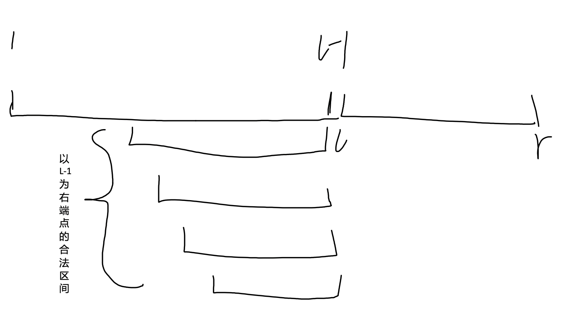

dp 进阶版练习

<!-- MORE -->

## CF258D

### 题目描述：

有一个长度为 $n$ 的排列，有 $m$ 次操作，操作为交换两个数 $a,b$ ，每次操作都有 $50\%$ 的概率进行，求进行 $m$ 次操作后期望逆序对个数

$n,m\le1000$ 

### 题目分析：

看到 $n$ 和 $m$ 都只有 $1000$ ，猜到复杂度应该是 $n^2$ 或者是 $n^2\log n$ 的。

一个很显然的想法是设 $f[x][y]$ 表示 $x$ 和 $y$ 的两个数能带来的逆序对期望。

初始化很显然，$f[x][y]=a[x]>a[y]$。

可以发现每次交换两个点，那么 $f[x][y]=f[y][x]=0.5$。

- $f[t][x]=f[t][y]=0.5\times (f[t][x]+f[t][y])$ 

- $f[x][t]=f[y][t]=0.5\times (f[x][t]+f[y][t])$ 

答案显然是 $\sum_{i=1}^{n}\sum_{j=i+1}^nf[i][j]$。

### 代码：

```cpp
int n,m,a[N];
db dp[N][N],ans=0;
 
signed main(){
    scanf("%d%d",&n,&m);
    for (int i=1;i<=n;i++) scanf("%d",&a[i]);
    for (int i=1;i<=n;i++)
        for (int j=1;j<=n;j++)
            dp[i][j]=a[i]>a[j];
    for (int i=1;i<=m;i++){
        int x=read(),y=read();
        for (int j=1;j<=n;j++){
            dp[j][x]=dp[j][y]=0.5*(dp[j][x]+dp[j][y]);
            dp[x][j]=dp[y][j]=0.5*(dp[x][j]+dp[y][j]);
        }
        dp[x][y]=dp[y][x]=0.5;
    }
    for (int i=1;i<=n;i++)
        for (int j=i+1;j<=n;j++)
            ans=ans+dp[i][j];
    printf("%.8lf",ans);
    return 0;
}
```

## CF1185G2

### 题目描述：

你现在正在选择歌曲。现在有 $n$ 首歌，每首歌都有一个时长 $t$ 和编号 $g$（$g\le 3$）。

现在需要求出有多少种选出来若干首歌排成一排的方案，使得任意相邻的编号不同，且所有歌的时长恰好为 $T$。

### 题目分析：

第一想法是直接设 $dp[i][j][t]$ 表示前 $i$ 首歌，最后一首的编号为 $j$，时长为 $t$ ，但是发现是序列，不需要顺序，并且枚举的复杂度炸天，所以这个 $dp$ 假了。

换一种方向思考，可不可以设 $dp[i][j][k][t]$ 表示 $1$ 编号的个数为 $i$ 个，$2$ 编号的个数为 $j$ 个，$3$ 编号的个数为 $k$ 个，$t$ 为时长。

发现可以直接做，但是编号问题还是非常的难搞，我们可以分成两部分考虑：

1. 设 $f[i][j][k]$ 表示 $i$ 个 $1$ 标号，$j$ 个 $2$ 标号，$k$ 个 $3$ 标号任意排列，并且邻近的两个数的编号不同的方案数。

   设 $s[i][j][k][0/1/2]$ 表示 $i$ 个 $1$ 标号，$j$ 个 $2$ 标号，$k$ 个 $3$ 标号，最后一个加入的数的编号为 $0/1/2$ 的方案数，转移很简单不说。

   那么有 $f[i][j][k]=s[i][j][k][0]+s[i][j][k][1]+s[i][j][k][2]$。

2. 发现四维的 $dp$ 太大了会炸掉空间，考虑把他分成两部分做，第一部分为 $a[i][t]$ 表示 $i$ 个 $1$ 编号，总时长为 $t$ 的方案数。第二部分为 $b[i][j][t]$ 表示 $i$ 个 $2$ 编号，$j$ 个 $3$ 编号，总时长为 $t$ 的方案数。

   转移复杂度分别是 $n^2T$ 和 $n^3T$ 的，第一个转移是简单的，第二个可以分成两部分做，先做 $2$ 标号，再做 $3$ 标号，这样复杂度可以从 $n^4T$ 转化成 $n^3T$。

统计答案把两者乘起来就好。

### 代码：

```cpp
int n,T;
int t1[56][2507],t2[57][57][2507];
int s[56][56][56][4],f[56][56][56];
vector<int> a,b,c;
int A,B,C,fac[1007];
PII tmp[57];
int cnt;

void add(int &x,int y){
    x=(x+y)%mod;
}

void dp1(){
    s[1][0][0][0]=s[0][1][0][1]=s[0][0][1][2]=1;
    for(int i=0;i<=A;i++){
        for(int j=0;j<=B;j++){
            for(int k=0;k<=C;k++) {
                for(int d=0;d<3;d++){
                    if(int v=s[i][j][k][d]){
                        if(d) add(s[i+1][j][k][0],v);
                        if(d^1) add(s[i][j+1][k][1],v);
                        if(d^2) add(s[i][j][k+1][2],v);
                    }
                }
                add(f[i][j][k],s[i][j][k][1]);
                add(f[i][j][k],s[i][j][k][2]);
                add(f[i][j][k],s[i][j][k][0]);
                f[i][j][k]=f[i][j][k]*fac[i]%mod*fac[j]%mod*fac[k]%mod;
            }
        }
    }
}

void dp2(){
    t1[0][0]=1;
    for (int i=0;i<A;i++){
        for (int j=i;j>=0;j--){
            for (int t=T-a[i];t>=0;t--){
                add(t1[j+1][t+a[i]],t1[j][t]);
            }
        }
    }
    t2[0][0][0]=1;
    for (int i=0;i<B;i++){
        for (int j=i;j>=0;j--){
            for (int t=T-b[i];t>=0;t--){
                add(t2[j+1][0][t+b[i]],t2[j][0][t]);
            }
        }
    }
    for (int i=0;i<C;i++){
        for (int j=B;j>=0;j--){
            for (int k=i;k>=0;k--){
                for (int t=T-c[i];t>=0;t--){
                    add(t2[j][k+1][t+c[i]],t2[j][k][t]);
                }
            }
        }
    }
}

signed main(){
    scanf("%lld%lld",&n,&T);
    for (int i=1;i<=n;i++){
        int x=read(),y=read();
        if (y==1) a.p_b(x);
        else if (y==2) b.p_b(x);
        else c.p_b(x);
    }
    A=a.size();B=b.size();C=c.size();
    fac[0]=1;
    for (int i=1;i<=1000;i++) fac[i]=(fac[i-1]*i)%mod;
    dp1();dp2();
    int ans=0;
    for (int j=0;j<=B;j++){
        for (int k=0;k<=C;k++){
            for (int t=0;t<=T;t++){
                if (t2[j][k][t]){
                    for (int i=0;i<=A;i++){
                        if (t1[i][T-t]){
                            add(ans,t1[i][T-t]*t2[j][k][t]%mod*f[i][j][k]);
                        }
                    }
                }
            }
        }
    }
    printf("%lld\n",ans);
    return 0;
}
```

## CF1223F

### 题目描述：

给一个序列进行栈操作，从左到右入栈，若当前入栈元素等于栈顶元素，则栈顶元素出栈，否则当前元素入栈。若进行操作后栈为空，说明这个序列可以被删除。

现在给你一个长度为 $n$ 的序列 $a$，问 $a$ 中有多少个子串可以被删除

### 题目分析：

第一思路是设 $dp[l][r]$ 表示 $l,r$ 这个区间是否是一个可删除区间，发现复杂度是 $n^3$ ，寄。

第二思路是枚举右端点 $r$，找到左端点 $l$ 可以在的位置，为了方便统计答案，设 $dp[r]$ 表示以 $r$ 为右端点的合法区间的个数。那么如果以 $r$ 为右端点的最短合法区间的左端点为 $l$ ，那么有 $dp[r]=dp[l-1]+1$。



如上图，可以发现左边的合法区间和右边的区间并且来仍然是合法区间，并且多了 $l,r$ 这个合法区间，所以 $dp[r]=dp[l-1]+1$。

发现目前最麻烦的就是 $l-1$ ，当然可以直接暴力枚举，找到 $l$，但是 $n\le 1e5$ 所以很好卡。

想想有什么方法可以存出来第一个合法区间的值，想到用 $map[i][a[i]]$ 表示以 $i$ 为右端点，$a[i]$ 最后出现的位置

那么 $map[i-1][a[i]]$ 就是 $l$，并 $map[i]=map[l-1]$ ，因为你发现这段区间合法之后，以后就再也不会用到这个区间了，相当于这个区间被抹除了。

### 代码：

```cpp
int n,a[N],pre[N],dp[N];
map<int,int> mp[N];

void solve(){
    scanf("%lld",&n);
    for (int i=1;i<=n;i++) scanf("%lld",&a[i]);
    for (int i=1;i<=n;i++){
        pre[i]=0;
        if (mp[i-1][a[i]]){
            int pos=mp[i-1][a[i]];
            pre[i]=pos;
            swap(mp[i],mp[pos-1]);
        }
        mp[i][a[i]]=i;
    }
    int ans=0;
    for (int i=1;i<=n;i++){
        if (!pre[i]) continue;
        dp[i]=dp[pre[i]-1]+1;
        ans+=dp[i];
    }
    printf("%lld\n",ans);
    for (int i=1;i<=n;i++) mp[i].clear(),dp[i]=0;
}

signed main(){
    int T=read();
    while(T--) solve();
    return 0;
}
```

 ## CF382E

### 题目描述：

有一个 $n$ 个节点的树，除了 $1$ 号节点至多与另外 $2$ 个节点连边，其余至多与 $3$ 个结点连边（也就是二叉树）。

两个树是相同的，当且仅当每个节点的相连节点都相同。

求有多少种不同的这样的树，满足最大匹配是 $k$，答案对 $1e9+7$ 取模。

### 题目分析：

对于最大匹配显然的一个贪心就是，从叶子节点开始匹配，如果该点和他的父亲都没有被匹配，那么选上就好了。

看起来就很难做，所以大概率是个 $dp$。

设 $dp[i][j][0/1]$ 表示 $i$ 个点的子树里有 $j$ 个匹配，并且根节点是否被匹配上的方案数。

为了不记重复的答案，枚举是就保证 $l_n\le r_n$。

每次转移枚举一个子树的信息，另一个子树可以算出来，设左子树的大小为 $l_n$，右子树的大小为 $r_n$，那么转移的时候要乘上一个系数：$\binom {l_n+r_n}{l_n}\times (l_n+r_n+1)$，前面是因为要在这些数里面，找出 $l_n$ 个数作为左子树，右边是因为要从 $l_n+r_n+1$ 个数里面找出一个数作为根。

**注意**虽然保证了 $l_n\le r_n$ ，但是还有 $l_n=r_n$ 的情况，直接将答案除于二就好了。

发现枚举顺序比较难搞，所以直接 $dfs+$ 记搜就好了。

### 代码：

```cpp
int dp[55][55][2],n,k;
int fac[N],ifac[N];
bool vis[55][55][2];

int qmi(int a,int k){
    int res=1;
    for (;k;k>>=1,a=a*a%mod) if (k&1) res=res*a%mod;
    return res;
}

int C(int n,int m){
    if (n<m||n<0||m<0) return 0;
    return fac[n]*ifac[m]%mod*ifac[n-m]%mod;
}

int Dp(int n,int k,int p){
    if (vis[n][k][p]) return dp[n][k][p];
    if (n==0&&k==0&&p==1) return 1;
    else if (n==0) return 0;
    if (n==1&&k==0&&p==0) return 1;
    else if (n==1) return 0;
    FOR(l_n,0,n-1){
        int r_n=n-l_n-1;
        if (r_n<l_n) break;
        FOR(l_k,0,k){
            FOR(l_p,0,1){
                FOR(r_p,0,1){
                    if ((!l_p||!r_p)&&p){
                        int r_k=k-l_k-1;
                        int tmp=Dp(l_n,l_k,l_p)*Dp(r_n,r_k,r_p)%mod*C(l_n+r_n,l_n)%mod*(l_n+r_n+1)%mod;
                        if (l_n==r_n) tmp=tmp*qmi(2,mod-2)%mod;
                        dp[n][k][p]=(dp[n][k][p]+tmp)%mod;
                    }
                    else if (l_p&&r_p&&!p){
                        int r_k=k-l_k;
                        int tmp=Dp(l_n,l_k,l_p)*Dp(r_n,r_k,r_p)%mod*C(l_n+r_n,l_n)%mod*(l_n+r_n+1)%mod;
                        if (l_n==r_n) tmp=tmp*qmi(2,mod-2)%mod;
                        dp[n][k][p]=(dp[n][k][p]+tmp)%mod;
                    }
                }
            }
        }
    }
    vis[n][k][p]=1;
    return dp[n][k][p];
}

signed main(){
    scanf("%lld%lld",&n,&k);fac[0]=1;
    for (int i=1;i<=n;i++) fac[i]=fac[i-1]*i%mod;
    ifac[n]=qmi(fac[n],mod-2);
    for (int i=n-1;i>=0;i--) ifac[i]=ifac[i+1]*(i+1)%mod;
    printf("%lld\n",(Dp(n,k,0)+Dp(n,k,1)%mod)*qmi(n,mod-2)%mod);
    return 0;
}
```

## CF1699E

### 题目描述：

给你个一个初始有 $n$ 个元素的可重复集合 $A$，其中每个元素都在 $1$ 到 $m$ 之间。

每次操作可以将 $A$ 中的一个元素（称之为 $x$）从 $A$ 中删除，然后从 $A$ 中加入两个元素 $p,q$，满足 $p·q=x$ 且 $p,q>1$。

定义 $A$ 的平衡值为 $A$ 中的最大数减去最小数，求任意次操作后可以得到的最小平衡值。

### 题目分析：

上来想到设 $dp[x][y]$ 表示 $x$ 为 $A$ 中最大，$y$ 为 $A$ 中最小，但是光存数组空间就炸了，所以说这种方法不可行。（说不定可以做，但是我不会优化/kk）

后来又想到了把他质因数分解之后可不可做，发现好像更麻烦了。

考虑既然是极差最小，可不可以枚举最小值，然后把所有数都分解为大于等于最小值的数，让分解后的数最小。

设 $dp[i][j]$ 表示讲将数 $i$ 分解成大于等于 $j$ 的数，能分解出来的最小的数是什么。

转移的话就分类讨论一下：

- 若 $j\nmid i$，则 $dp[i][j+1]\to dp[i][j]$ （因为 $j$ 这个数没法被分解出来，根据定义，要从 $j+1$ 转移过来）
- 若 $j\mid i$，则 $dp[\frac{i}{j}][j]\to dp[i][j]$

那么我们可以从大到小枚举最小值，去掉第二维，并且 $j\nmid i$ 的转移也不需要了。

**注意**为了防止分解出来的数 $\le i$，枚举他的倍数的时候要从 $i\times i$ 开始枚举。

还要保证 $i\le \min{a_k}$，不然 $\min{a_k}$ 再怎么分解都比 $i$ 小。

最后还需要计算最大值，直接暴力找最大值出现的地方复杂度就炸开了，但是可以发现一个性质：

当最小值变小的时候，最大值也同样会变小，所以可以搞一个双指针，做到 $O(n)$。

总复杂度为 $O(n\log n)$。

### 代码：

```cpp
int n,m,a[N],tot[N],dp[N];
bool vis[N];
vector<int> G[N];

void Main(){
    scanf("%lld%lld",&n,&m);int mn=INF;
    for (int i=1;i<=n;i++){
        scanf("%lld",&a[i]);
        vis[a[i]]=1;
        mn=min(mn,a[i]);
    }
    for (int i=1;i<=m;i++){
        dp[i]=i;
        if (vis[i]) tot[dp[i]]++;
    }
    int ans=INF,mx=m;
    for (int i=m;i>=1;i--){
        for (int j=i*i;j<=m;j+=i){
            if (vis[j]) tot[dp[j]]--;
            dp[j]=min(dp[j],dp[j/i]);
            if (vis[j]) tot[dp[j]]++;
        }
        while(!tot[mx]) mx--;
        if (i<=mn) ans=min(ans,mx-i);
    }
    printf("%lld\n",ans);
    for (int i=1;i<=m;i++) vis[i]=tot[i]=0;
}
signed main(){
    int T=read();
    while(T--) Main();
    return 0;
}
```


## CF1700F

### 题目描述：

给定两个 $2\times n$ 的 $01$ 矩阵 $A$ 和 $B$，定义一次操作为交换 $A$ 中两个相邻的值，输出使 $A=B$ 的最小操作次数，如果无法使 $A=B$，那么输出 $-1$。

### 题目分析：

我们先考虑只有一行应该怎么做，是一个很典的问题，设 $a_i$ 表示 $A$ 的前缀和，$b_i$ 表示 $B$ 的前缀和，那么答案就是 $\sum_{i=1}^{n}|a_i-b_i|$，思考下这个过程是在干什么，


相当于枚举每个间隔，$A$ 有多少个 $1$，$B$ 有多少个 $1$，看看每个格子需要被经过多少次。

考虑两行怎么做，什么时候上下行会交换？

和上面一样分析，对于每个间隔，同样是两个绝度值相减，上下交换的时候，当且仅当 上一行为 **01** 下一行为 **10** 的情况，或者上一行为 **10** 下一行为 **01** 的情况，因为这样上下行交换一次，可以节约 $2-1$ 的贡献。

**注意**交换完之后前缀的大小也要更新。

### 代码：

```cpp
int n,a[3][N],b[3][N];
int A,B;

signed main(){
    scanf("%lld",&n);
    for (int i=1;i<=2;i++){
        for (int j=1;j<=n;j++){
            scanf("%lld",&a[i][j]);
            A+=a[i][j];
        }
    }
    for (int i=1;i<=2;i++){
        for (int j=1;j<=n;j++){
            int x=read();
            b[i][j]=b[i][j-1]+x;B+=x;
        }
    }
    if (A!=B) return puts("-1"),0;
    int a1=0,a2=0,ans=0;
    for (int i=1;i<=n;i++){
        a1+=a[1][i],a2+=a[2][i];
        if (a1<b[1][i]&&a2>b[2][i]) a1++,a2--,ans++;
        if (a1>b[1][i]&&a2<b[2][i]) a1--,a2++,ans++;
        ans+=abs(a1-b[1][i])+abs(a2-b[2][i]);
    }
    printf("%lld\n",ans);
    return 0;
}
```

## CF1111D

### 题目描述：

有一个恶棍的聚居地由几个排成一排的洞穴组成，每一个洞穴恰好住着一个恶棍。

每种聚居地的分配方案可以记作一个长为**偶数**的字符串，第$i$个字符代表第$i$个洞里的恶棍的类型。

如果一个聚居地的分配方案满足对于所有类型，该类型的所有恶棍都住在它的前一半或后一半，那么钢铁侠可以摧毁这个聚居地。

钢铁侠的助手贾维斯有不同寻常的能力。他可以交换任意两个洞里的野蛮人（即交换字符串中的任意两个字符）。并且，他可以交换任意次。

现在钢铁侠会问贾维斯$q$个问题。每个问题，他会给贾维斯两个数$x$和$y$。贾维斯要告诉钢铁侠，从当前的聚居地分配方案开始，他可以用他的能力创造多少种不同的方案，使得与原来住在第$x$个洞或第$y$个洞中的恶棍类型相同的所有恶棍都被分配到聚居地的同一半，同时满足钢铁侠可以摧毁这个聚居地。

如果某一个洞里的恶棍在两种方案中类型不同，则这两种方案是不同的。

### 题目分析：

考虑没有 $x,y$ 的限制怎么做。

首先类型相同的要放在同一部分，所以每个类型相同的都要一起算贡献，因此下文我们用 $c_i$ 表示 $i$ 这个数出现过多少次方便统计贡献。

可以发现，我们想求的其实就选任意多个类型 $c$，让他们的和加起来为 $n/2$，假如选出来的集合是 $S$，那么贡献就是 $\prod_{i\in S}\binom{n}{c_1}\binom{n-c_1}{c_2}\binom{n-c_1-c_2}{c_2}...$，这样乘下去，化简一下就是 $\frac{\frac{n}{2}!}{\prod_{i\in S}c_i!}$，这只是算了左边的，那么右边的答案就是 $\frac{\frac{n}{2}!}{\prod_{i\notin S}c_i!}$，两者组合起立之后对答案的贡献就是：
$$
\frac{(\frac{n}{2}!)^2}{\prod_{i}c_i}
$$
所以我们本质上只需要用 $dp$ 算出来 $n/2$ 可以凑出来的方案数，乘上上面的系数，就可以得到答案了

现在我们考虑加上 $x,y$ 的限制怎么做。

一个思路是用可删除 dp 做。

另一个思路是强制一个不选，另一个用前缀和后缀 dp 合并得到答案。

这些东西都可以预处理得到，最后答案 $O(1)$ 输出即可。

### 代码：

这里给一份通俗易懂的，因为有 `memset` ，所以需要卡卡常数并且用 `c++20` 才能过。

```cpp
char s[N];
int cnt[54],tmp=1,Q,n;
int fac[N],ifac[N];
int ans[54][54],f[54][N],g[54][N];

int qmi(int a,int k){
    int res=1;
    for (;k;k>>=1,a=a*a%mod) if (k&1) res=res*a%mod;
    return res;
}

int get(char s){
    if (s>='a'&&s<='z') return s-'a'+1;
    else return s-'A'+1+26;
}

void add(int &x,int y){
    x=(x+y)%mod;
}

signed main(){
    scanf("%s",s+1);
    n=strlen(s+1);fac[0]=1;
    for (int i=1;i<=n;i++) cnt[get(s[i])]++;
    for (int i=1;i<=n;i++) fac[i]=fac[i-1]*i%mod;
    ifac[n]=qmi(fac[n],mod-2);
    for (int i=n-1;i>=0;i--) ifac[i]=ifac[i+1]*(i+1)%mod;
    tmp=fac[n/2]*fac[n/2]%mod*2%mod;
    for (int i=1;i<=52;i++) tmp=tmp*ifac[cnt[i]]%mod;
    for (int i=1;i<=52;i++){
        memset(f,0,sizeof f);memset(g,0,sizeof g);
				f[0][0]=1;
        for (int j=0;j<52;j++){//前 j 个不算 i 的方案数
            for (int k=0;k<=n/2;k++){
                add(f[j+1][k],f[j][k]);
                if (j+1!=i&&cnt[j+1]) add(f[j+1][k+cnt[j+1]],f[j][k]);
            }
        }
				g[53][0]=1;
        for (int j=53;j>1;j--){//后 j 个不算 i 的方案数
            for (int k=0;k<=n/2;k++){
                add(g[j-1][k],g[j][k]);
                if (j-1!=i&&cnt[j-1]) add(g[j-1][k+cnt[j-1]],g[j][k]);
            }
        }
        for (int j=1;j<=52;j++){
            for (int k=0;k<=n/2;k++)
                add(ans[i][j],f[j-1][k]*g[j+1][n/2-k]%mod);
        }
    }
    for (int i=1;i<=52;i++){
        for (int j=1;j<=52;j++){
            ans[i][j]=ans[i][j]*tmp%mod;
        }
    }
    scanf("%lld",&Q);
    while(Q--){
        int x=read(),y=read();
        printf("%lld\n",ans[get(s[x])][get(s[y])]);
    }
    return 0;
}
```

可过的代码：[Code](https://codeforces.com/contest/1111/submission/222181265)。
