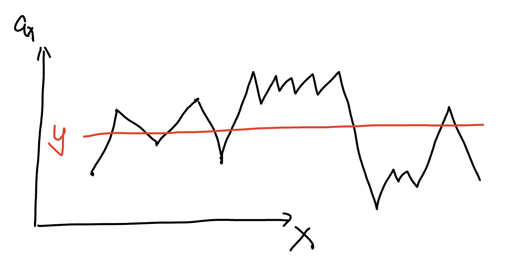

<!-- MORE -->

## T1

[loj 3092](https://loj.ac/p/3092)

### 题目描述：

小 C 正在玩一款排兵布阵的游戏。在游戏中有 $n$ 座城堡，每局对战由两名玩家来争夺这些城堡。每名玩家有 $m$ 名士兵，可以向第 $i$ 座城堡派遣 $a_i$ 名士兵去争夺这个城堡，使得总士兵数不超过 $m$。   

如果一名玩家向第 $i$ 座城堡派遣的士兵数**严格**大于对手派遣士兵数的两倍，那么这名玩家就占领了这座城堡，获得 $i$ 分。  

现在小 C 即将和其他 $s$ 名玩家两两对战，这 $s$ 场对决的派遣士兵方案必须相同。小 C 通过某些途径得知了其他 $s$ 名玩家即将使用的策略，他想知道他应该使用什么策略来最大化自己的总分。   

由于答案可能不唯一，你只需要输出小 C 总分的最大值。

对于 $100\%$ 的数据：$1\le s \le 100$，$1\le n \le 100$，$1\le m \le 20000$，对于每名玩家 $a_i \ge 0$。$\sum\limits_{i=1}^n a_i \le m$。

### 题目分析：

考虑每个位置可以选择放任意个人，但是真正有意义的人一定是 $x\times2+1$ 这样的，那么每个位置可以按照对手的人数排序，然后判断选多少个人放在这里，看起来是一个背包的形式，直接做即可。

### 代码：

<details>
  <summary> 点击查看代码 </summary>


  ```cpp
const int INF=1e9+7;

int dp[20007];
int n,m,s;
vector<int> t[107];
vector<PII> v[107];

signed main(){
    scanf("%lld%lld%lld",&s,&n,&m);
    for (int i=1;i<=s;i++){
        int x;
        for (int j=1;j<=n;j++){
            x=read();
            t[j].p_b(x);
        }
    }
    for (int i=1;i<=n;i++) sort(t[i].begin(),t[i].end());
    for (int i=1;i<=n;i++)
        for (int j=0;j<t[i].size();j++)
            v[i].p_b({t[i][j]*2+1,(j+1)*i});
    for (int i=1;i<=n;i++){
        for (int j=m;j>=0;j--){
            for (auto k:v[i]){
                if (k.fi<=j){
                    dp[j]=max(dp[j],dp[j-k.fi]+k.se);
                }
            }
        }
    }
    printf("%lld\n",dp[m]);
    return 0;
}
  ```

</details>

## T2

[loj 3093](https://loj.ac/p/3093)

目前还没补，补完再写

### 题目描述：

当一束光打到一层玻璃上时，有一定比例的光会穿过这层玻璃，一定比例的光会被反射回去，剩下的光被玻璃吸收。  

设对于任意 $x$，有 $x \times a_i\%$ 单位的光会穿过它，有 $x \times b_i\%$ 的会被反射回去。  

现在 $n$ 层玻璃叠在一起，有 $1$ 单位的光打到第 $1$ 层玻璃上，那么有多少单位的光能穿过**所有** $n$ 层玻璃呢？

对于 $100\%$ 的数据，$n\le 5\times 10^5$，$1\le a_i \le 100$，$0\le b_i \le 99$，$1\le a_i+b_i \le 100$。  

## T3

[loj 2732](https://loj.ac/p/2732)

### 题目描述：

JOI 社为了扩大业务而开始了新社员招募。社员有 $N$ 名候补者，编号从 $1$ 到 $N$， 每名候补者有称为评价值的一个确定整数。 评价值高于某一个值的候补者全部都将被聘用， 他们还将分为几个组别。如果 $a, b(a \lt b)$ 同时被聘用且 $c(a \le c\le b)$ 全部被聘用时，$a,b$ 进入同一组。

你要处理 $M$ 个查询，查询有以下两种：

1. 评价值 $B_j$ 以上的候补者全部聘用时的组数；
2. 将候补者 $C_j$ 的评价值更新为 $D_j$。

### 题目分析：

首先把题意转化一下，其实就是要求 $\ge B_j$ 所形成的连续段个数。

上来想直接用线段树维护，发现在序列上完全不可做，然后考虑了下分块，也不是很会。

但是如果把整张图转化成这样，就会看着舒服很多：



也就是说，你只需要找到 $y$ 经过了多少次黑线，然后除于二就是答案，为了更加方便，我们只求经过类似 $a_i<a_{i+1}$ 的黑线。

接着换一种方向考虑，对于 $a_i$ 和 $a_{i+1}$，满足 $a_i< a_{i+1}$，则可以对 $y=a_i+1$ 到 $y=a_{i+1}$ 的红线产生贡献，发现最后其实用到了区间加和单点求和，线段树或者树状数组求即可

**注意**，因为 $x$ 很大，所以需要离散化下来再做。

### 代码：

<details>
  <summary> 点击查看代码 </summary>


  ```cpp
const int INF=1e9+7;
const int N=1e6+7;

int n,m,a[N],num[N],cnt;
struct Query{
    int opt,x,y;
}q[N];

namespace SG{
    struct node{
        int l,r;
        int sum,tag;
    }t[N<<2];
    void pushup(int p){
        t[p].sum=t[ls(p)].sum+t[rs(p)].sum;
    }
    void build(int l,int r,int p){
        t[p].sum=t[p].tag=0;
        t[p].l=l,t[p].r=r;
        if (l==r) return;
        int mid=(l+r)>>1;
        build(l,mid,ls(p)),build(mid+1,r,rs(p));
        pushup(p);
    }
    void add(int p,int k){
        t[p].sum+=(t[p].r-t[p].l+1)*k;
        t[p].tag+=k;
    }
    void pushdown(int p){
        if (!t[p].tag) return;
        add(ls(p),t[p].tag);
        add(rs(p),t[p].tag);
        t[p].tag=0;
    }
    void modify(int ql,int qr,int l,int r,int p,int k){
        if (ql<=l&&qr>=r) return add(p,k),void();
        int mid=(l+r)>>1;pushdown(p);
        if (ql<=mid) modify(ql,qr,l,mid,ls(p),k);
        if (qr>mid) modify(ql,qr,mid+1,r,rs(p),k);
        pushup(p);
    }
    int query(int pos,int l,int r,int p){
        if (l==r) return t[p].sum;
        int mid=(l+r)>>1;pushdown(p);
        if (pos<=mid) return query(pos,l,mid,ls(p));
        else return query(pos,mid+1,r,rs(p));
    }
}using namespace SG;

int find(int x){
    return lower_bound(num+1,num+cnt+1,x)-num;
}

signed main(){
    scanf("%d%d",&n,&m);
    for (int i=1;i<=n;i++){
        scanf("%d",&a[i]);
        num[++cnt]=a[i];
    }
    for (int i=1;i<=m;i++){
        scanf("%d",&q[i].opt);
        if (q[i].opt==1) {
            scanf("%d",&q[i].x);
            num[++cnt]=q[i].x;
        }
        else{
            scanf("%d%d",&q[i].x,&q[i].y);
            num[++cnt]=q[i].y;
        }
    }
    sort(num+1,num+cnt+1);
    cnt=unique(num+1,num+cnt+1)-num-1;
    for (int i=1;i<=n;i++) a[i]=find(a[i]);
    for (int i=1;i<=m;i++){
        if (q[i].opt==1) q[i].x=find(q[i].x);
        else q[i].y=find(q[i].y);
    }
    build(0,cnt,1);
    for (int i=0;i<=n;i++)
        if (a[i]<a[i+1])
            modify(a[i]+1,a[i+1],0,cnt,1,1);
    for (int i=1;i<=m;i++){
        if (q[i].opt==1)
            printf("%d\n",query(q[i].x,0,cnt,1));
        else{
            int x=q[i].x;
            if (a[x-1]<a[x]) modify(a[x-1]+1,a[x],0,cnt,1,-1);
            if (a[x]<a[x+1]) modify(a[x]+1,a[x+1],0,cnt,1,-1);
            a[x]=q[i].y;
            if (a[x-1]<a[x]) modify(a[x-1]+1,a[x],0,cnt,1,1);
            if (a[x]<a[x+1]) modify(a[x]+1,a[x+1],0,cnt,1,1);
        }
    }
    return 0;
}
  ```

</details>

## T4

[loj 3076](https://loj.ac/p/3076)

感觉完全不会/kk

