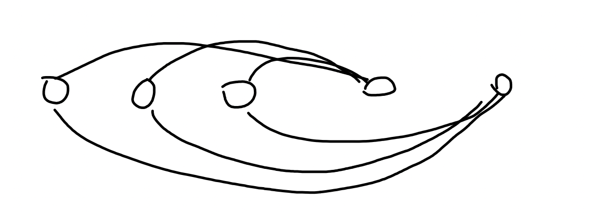
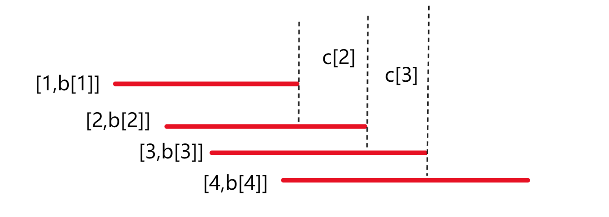

这下成 pkusc 2021 选练了。

<!-- MORE -->

## T1

### 题目描述：

给定一个整数数列 $a$，定义 $f(a)=\max_{i\le i<j\le n}\{a_j-a_i\}$，保证 $f(a)>0$。你需要求出至少需要修改 $a$ 的多少个位置才能使 $f(a)$ 变小。注意，你修改之后的数也必须是整数。

$2\le n\le 10^6$，$|a_i|\le 10^9$。

### 题目分析：

上来看到这个题，想着直接冲，从后往前枚举，如果后缀的最大值减去 $a_i$ 大于最大的差，那就把最大值删掉，然后把最大的差换成现在的。

想了个 $\text{conner case}$ 把自己 $\text{hack}$ 掉了，因为遇到 $00101$ 这样的数据就挂了。

发现可以先把最大的差求出来，然后如果最大值减去 $a_i$ 等于最大差的话，在删掉最大值，并把 $\text{ans++}$。

写了个 $2^n$ 的对拍，没想到怎么拍都拍不挂，考虑证明一下这个算法对不对。

假如说 $a_j-a_i$ 为最大的差，那么我们就让 $i$ 向 $j$ 连一条边，发现最后的图肯定好几个和下面一样的图拼起来的。



而且不会出现任何的重叠和交集，这个是好证明的。

所以说变成了一个二分图最小点覆盖的问题，那我们上面的那个操作，不就是相当于在贪心网络流，所以说这个算法是对的。

能贪心流的原因是因为每条边的流量全部都是 $1$。

### 代码：

<details>
  <summary> 点击查看代码： </summary>


  ```cpp
const int INF=1e9+7;
const int N=1e6+7;

int n,a[N];
int ans=0,sum=0;

signed main(){
    scanf("%lld",&n);
    for (int i=1;i<=n;i++) scanf("%lld",&a[i]);
    int mx=a[n];
    for (int i=n-1;i>=1;i--){
        if (mx-a[i]>ans) ans=mx-a[i];
        mx=max(mx,a[i]);
    }
    priority_queue<int> q;
    for (int i=n;i>=1;i--){
        if (q.empty()){
            q.push(a[i]);
            continue;
        }
        int mx=q.top();
        if (mx-a[i]==ans){
            sum++,q.pop();
        }
        q.push(a[i]);
    }
    printf("%lld\n",sum);
    return 0;
}
  ```

</details>

## T2

### 题目描述：

给定一个长度为 $n$ 的序列 $a_1,a_2,\cdots,a_n$，有 $m$ 次操作，每次的操作为如下两种形式之一：

1. `1 l r`：从左到右遍历 $[l,r-1]$ 中的每个 $i$，让 $a_i=\max(a_i,a_i+1)$。
2. `2 l r`：输出 $[l,r]$ 中所有的前缀最大值的和，即对于所有满足 $l\le i\le r$ 且 $\max\limits_{l\le j<i}\{a_j\}<a_i$ 的 $i$，求 $a_i$ 的和。

保证初始时 $a_i$ 两两不同。

对于 $40\%$ 的数据，保证所有的 $1$ 类操作，有 $l=1,r=n$。

对于 $100\%$ 的数据，保证：$1\le n,m\le 3\times 10^5$，$1\le a_i\le 10^9$，$l<r$。

### 题目分析：

如果没有 $1$ 操作，那么就是[楼房重建](https://www.luogu.com.cn/problem/P4198)，直接做即可。

考虑加入 $1$ 操作，并且 $1$ 操作全是全局的。

设 $b_i$ 表示 $a_l'=\max\limits_{i=l}^{b_i}(a_i)$，假设前面已经有过 $t$ 次 $1$ 操作，那么现在的答案即为 $\max(a_l,a_{l+1},\cdots,a_{b_i}),a_{l+t+1},a_{l+t+2},\cdots,a_{r+t}$ 的前缀最大值之和。

显然这个时候 $b_i=i+t$。

考虑操作 $1$ 不是全局修改时的情况，和前面的区别就是 $b$ 的修改方式变了，考虑修改一个 $[l,r]$，相当于把 $b_l$ 删除了，然后在 $r$ 后面复制了一份 $b_r$，显然可以用平衡树维护。

那么现在的答案应该是 $\max(a_l,\cdots,a_{b_l}),\max(a_{l+1},\cdots,a_{b_{l+1}}),\cdots,\max(a_r,\cdots,a_{b_r})$ 的前缀最大值之和。

设 $c_i = \max\limits_{i=b_{i-1}+1}^{b_i}(a_i)$，那么答案应该是 $\max(a_l,\cdots,a_{b_l}),c_{l+1},\cdots,c_r$ 的前缀最大值之和。



考虑一次修改，相当于把 $c_l$ 和 $c_{l-1}$ 给合并了，但是合并操作，其实可以看成删掉两个中较小的一个，考虑到线段树上做删除操作不是很会，所以说考虑换一种思路来实现 $c_i$。

首先你可以预处理出来每个点到 $n$ 的前缀最大值之和 $suf$，然后一个区间 $[l,r]$ 的前缀最大值之和其实就是 $suf_l-suf_{r+1}$。

考虑可不可以在 $suf$ 数组上建线段树，设 $c$ 前面第一个比自己大的位置为 $pos$，其实就是对 $suf_{pos+1}\sim suf_{c}$ 做了个区间减的操作。

统计答案的时候，找到 $b_l$ 和 $b_r$，让 $l=\max(a_l,a_l+1,\cdots,a_{b_l}),r=b_r$，然后求一个 $pos=\max(a_l,\cdots,a_r)$ 所在的位置，那么答案就是 $suf_l-suf_{pos+1}$，如果 $pos$ 被删掉过得话，那就减去 $pos$，但是如果 $a_l$ 被删去过得话，还需要把 $a_l$ 加回来，因为这里求得 $a_l$ 并不是 $c$ 范围内的，只是 $\max$ 求得的。

### 代码：

<details>
  <summary> 点击查看代码： </summary>


  ```cpp
const int INF=1e9+7;
const int N=6e5+7;

int a[N],n,Q;
int stk[N],cnt;
int suf[N],pre[N];// 后缀最大值的和，和前面第一个比自己大的数
bool flag[N];

struct FHQ{
	int val[N],sz[N],key[N],ls[N],rs[N];
	int rt = 0,cnt = 0;
	int newnode(int p){
        val[++cnt]=p;
        sz[cnt]=1;key[cnt]=g()%10000000;
        ls[cnt]=rs[cnt]=0;
        return cnt;
	}
	void pushup(int now){
		sz[now]=sz[ls[now]]+sz[rs[now]]+1;
	}
	void split(int now,int k,int &x,int &y){
		if(!now) return x=y=0,void();
		if(sz[ls[now]]+1<=k){
			x=now;
			split(rs[now],k-sz[ls[now]]-1,rs[x],y);
			pushup(now);
		}
		else{
			y=now;
			split(ls[now],k,x,ls[y]);
			pushup(now);
		}
	}
	int merge(int x,int y){
		if(!x||!y) return x|y;
		if(key[x] < key[y]){
			rs[x]=merge(rs[x],y);
            pushup(x);
			return x;
		}
		else{
			ls[y]=merge(x,ls[y]);
            pushup(y);
			return y;
		}
	}
	void insert(int pos,int p){
		int x,y;
		split(rt,pos-1,x,y);
		rt=merge(merge(x,newnode(p)),y);
	}
	void del(int pos){
		int x,y,z;
		split(rt,pos,x,y);
		split(x,pos-1,x,z);
		rt=merge(x,y);
	}
	int query(int now,int k){
        if (!now) return 0;
        if (sz[ls[now]]+1==k) return val[now];
        else if (sz[ls[now]]+1<k) return query(rs[now],k-sz[ls[now]]-1);
        else return query(ls[now],k);
    }
}fhq;

struct SG{
    #define ls(x) x<<1
    #define rs(x) x<<1|1
    struct node{
        int l,r;
        int sum,tag,mxp;
    }t[N<<2];
    void pushup(int p){
        t[p].sum=t[ls(p)].sum+t[rs(p)].sum;
    }
    void add(int p,int k){
        t[p].sum+=(t[p].r-t[p].l+1)*k;
        t[p].tag+=k;
    }
    void pushdown(int p){
        if (!t[p].tag) return;
        add(ls(p),t[p].tag);
        add(rs(p),t[p].tag);
        t[p].tag=0;
    }
    void build(int l,int r,int p){
        t[p].l=l;t[p].r=r;
        if (l==r){
            t[p].mxp=l;
            t[p].sum=suf[l];
            return;
        }
        int mid=(l+r)>>1;
        build(l,mid,ls(p));build(mid+1,r,rs(p));
        if (a[t[ls(p)].mxp]>a[t[rs(p)].mxp]) t[p].mxp=t[ls(p)].mxp;
        else t[p].mxp=t[rs(p)].mxp;
        pushup(p);
    }
    void modify(int ql,int qr,int l,int r,int p,int k){
        if (ql>qr) return;
        if (ql<=l&&qr>=r) return add(p,k),void();
        int mid=(l+r)>>1;pushdown(p);
        if (ql<=mid) modify(ql,qr,l,mid,ls(p),k);
        if (qr>mid) modify(ql,qr,mid+1,r,rs(p),k);
        pushup(p);
    }
    int query(int pos,int l,int r,int p){
        if (l==r) return t[p].sum;
        int mid=(l+r)>>1;pushdown(p);
        if (pos<=mid) return query(pos,l,mid,ls(p));
        else return query(pos,mid+1,r,rs(p));
    }
    int query_max(int ql,int qr,int l,int r,int p){
        if (ql>qr) return 0;
        if (ql<=l&&qr>=r) return t[p].mxp;
        int mid=(l+r)>>1;
        if (mid>=qr) return query_max(ql,qr,l,mid,ls(p));
        if (mid<ql) return query_max(ql,qr,mid+1,r,rs(p));
        int pos1=query_max(ql,qr,l,mid,ls(p));
        int pos2=query_max(ql,qr,mid+1,r,rs(p));
        if (a[pos1]>a[pos2]) return pos1;
        else return pos2;
    }
}t;

signed main(){
    scanf("%lld%lld",&n,&Q);
    for (int i=1;i<=n;i++){
        scanf("%lld",&a[i]);
        fhq.insert(i,i);
    }
    suf[0]=0;
    for (int i=n;i>=1;i--){
        while(cnt&&a[i]>a[stk[cnt]]){
            pre[stk[cnt]]=i;
            cnt--;
        }
        if (!cnt) suf[i]=a[i];
        else suf[i]=suf[stk[cnt]]+a[i];
        stk[++cnt]=i;
    }
    t.build(1,n,1);
    while(Q--){
        int opt=read(),l=read(),r=read();
        if (opt==1){
            fhq.insert(r+1,fhq.query(fhq.rt,r));
            int L1=fhq.query(fhq.rt,l-1)+1,R1=fhq.query(fhq.rt,l);
            fhq.del(l);
            int c1=0,c2=0;
            if (L1<=R1) c1=t.query_max(L1,R1,1,n,1);
            int L2=R1+1,R2=fhq.query(fhq.rt,l);
            if (L2<=R2) c2=t.query_max(L2,R2,1,n,1);
            if (c1!=c2&&c1&&c2){
                if (a[c1]>a[c2]) t.modify(pre[c2]+1,c2,1,n,1,-a[c2]),flag[c2]=1;
                else t.modify(pre[c1]+1,c1,1,n,1,-a[c1]),flag[c1]=1;
            }
        }
        else{
            l=t.query_max(l,fhq.query(fhq.rt,l),1,n,1),r=fhq.query(fhq.rt,r);
            int pos=t.query_max(l,r,1,n,1);
            int ans=t.query(l,1,n,1)-t.query(pos,1,n,1);
            if (!flag[pos]) ans+=a[pos];
            if (flag[l]) ans+=a[l];
            printf("%lld\n",ans);
        }
    }
    return 0;
}
  ```

</details>

## T3

### 题目描述：

有 $n$ 道菜品，第 $i$ 道菜品花费 $a_i$. 可以使用价值 $1$ 的消费券，初始时没有消费券。

如果在一道花费 $a$ 的菜品花费 $b(b\leq a)$ 张消费券，则实际需要花 $a−b$ 元，并在用餐结束后获得 $\left\lfloor\dfrac{a-b}{c}\right\rfloor$ 张消费券。

$Q$ 次对序列 $a_i$ 修改，每次修改结束后询问按照顺序品尝 $n$ 个菜品的最小消费。

**询问之间不独立。**

$1≤n,Q≤3×10^5,1≤c≤10^9,1≤ai≤10^{12}$。

### 题目分析：

首先有一个贪心的想法，每次买菜的时候，都尽量的花 $c$ 倍的金钱，去获得尽量多的代金券。

那么 $nq\log n$ 的做法就是直接暴力二分钱数，判断是否合法即可。

发现其实是想让我们的优惠券越多越好，因为总的钱数是固定的，都是 $\sum\limits_{i=1}^na_i$，所有优惠券越多，花费的金币越少，那么设 $f_i$ 表示决策完 $i$ 这个位置之后，优惠券最多能有多少，转移为：
$$
dp_i=\max(dp_{i-1}+\frac{a_i}{c}-a_i\%c,\frac{a_i}{c})
$$
分析另外一个性质就是，肯定有一个 $i$，使得 $i$ 之前全部使用金币，$i$ 这个位置可能金币也可能优惠券，或者是两者都有，然后 $i$ 之后全部都是用优惠券。

因为你完全可以通过调整，因为一次攒的操作如果放在后面，把他放到前面先攒上肯定是不劣的。

设 $R$ 表示 $i$ 这个位置最少需要 $R$ 个优惠券就可以买下所有的菜，设 $suf_i=\sum\limits_{j=i}^{n}a_i$，那么 $R$ 需要满足以下三个条件：
$$
1. R \le \frac{a_i}{c} \\
2. R\le suf_{i+1} \\
3. R +f_{i-1} \le suf_{i+1}+a_i-R\times c
$$
第一个条件是不能超过能买的最大值，第二个和第三个条件条件是不能多买了，不然就浪费了。

所以 $R=\min(\frac{a_i}{c},suf_{i+1},\frac{suf_{i+1}-f_{i-1}+a_i}{c+1})$。

如果 $R<0$ 了，说明前面留的优惠券太多了。

可以设 $pre_i=\sum\limits_{j=1}^{i}\frac{a_i}{c}$，这样的话最大优惠券的数量即 $x=R+pre_{i-1}$。

最小金币数就是总钱数减去优惠券的个数。

那么就可以去二分一个 $i$，然后求出来 $R$，现在的问题就变成了，怎么快速的维护 $f,suf,a,pre$ 这三个数组。

$suf,pre$ 和 $a$ 都可以直接用线段树维护，但是 $f$ 数组是一个 $\max(x+a,b)$ 的形式，考虑这个东西可不可以快速求值，显然可以直接用矩阵做，但是常数有 $8$ 之大，会 $\text{TLE}$。

考虑用 $(a,b)$ 来记录 $\max(x+a,b)$，那么对于一个 $x$，进行 $(a,b)$ 和 $(c,d)$ 这两个操作之后，会变成 $(a+c,\max(b+c,d))$。

可以自己推导一下：
$$
\max(\max(x+a,b)+c,d)\to \max(x+a+c,\max(b+c,d))
$$
这样整个题就做完了，复杂度为 $O(n\log^2 n)$，感觉我实现的挺不错的，但是常数挺大的，跑的倒数第二慢/qd。

### 代码：

<details>
  <summary> 点击查看代码： </summary>


  ```cpp
const int INF=1e18+7;
const int N=6e5+7;

struct node{
    int a,b;
    int sum,sum2;
}t[N<<2];

node operator + (const node &a,const node& b){
    node c;
    int A=a.a,B=a.b,C=b.a,D=b.b;
    c.a=A+C,c.b=max(C+B,D);
    c.sum=a.sum+b.sum;
    c.sum2=a.sum2+b.sum2;
    return c;
}

int n,a[N],Q,c;

void pushup(int p){
    t[p]=t[ls(p)]+t[rs(p)];
}

void build(int l,int r,int p){
    if (l==r){
        t[p].sum=a[l];
        t[p].a=(a[l]/c)-(a[l]%c),t[p].b=a[l]/c;
        t[p].sum2=a[l]/c;
        return;
    }
    int mid=(l+r)>>1;
    build(l,mid,ls(p)),build(mid+1,r,rs(p));
    pushup(p);
}

void modify(int pos,int l,int r,int p){
    if (l==r){
        t[p].sum=a[l];
        t[p].a=(a[l]/c)-(a[l]%c),t[p].b=a[l]/c;
        t[p].sum2=a[l]/c;
        return;
    }
    int mid=(l+r)>>1;
    if (pos<=mid) modify(pos,l,mid,ls(p));
    else modify(pos,mid+1,r,rs(p));
    pushup(p);
}

node query(int ql,int qr,int l,int r,int p){
    if (ql>qr){
        node c;
        c.a=c.b=c.sum=c.sum2=0;
        return c;
    }
    if (ql<=l&&qr>=r) return t[p];
    int mid=(l+r)>>1;node c;
    c.a=c.b=c.sum=c.sum2=0;
    if (ql<=mid) c=c+query(ql,qr,l,mid,ls(p));
    if (qr>mid) c=c+query(ql,qr,mid+1,r,rs(p));
    return c;
}

int solve(){
    int l=1,r=n,ans=0;
    while(l<=r){
        int mid=(l+r)>>1;
        node x=query(1,mid-1,1,n,1);
        int f=max(x.a,x.b);
        int pre=x.sum2;
        node y=query(mid+1,n,1,n,1);
        int suf=y.sum;
        int res=min({a[mid]/c,suf,(suf+a[mid]-f)/(c+1)});
        if (res<0) r=mid-1;
        else {l=mid+1;ans=max(ans,res+pre);}
    }
    return t[1].sum-ans;
}

signed main(){
    scanf("%lld%lld%lld",&n,&Q,&c);
    for (int i=1;i<=n;i++) a[i]=read();
    build(1,n,1);
    printf("%lld\n",solve());
    while(Q--){
        int x=read(),y=read();
        a[x]=y;
        modify(x,1,n,1);
        printf("%lld\n",solve());
    }
    return 0;
}
  ```

</details>

## T4

会不了一点。

