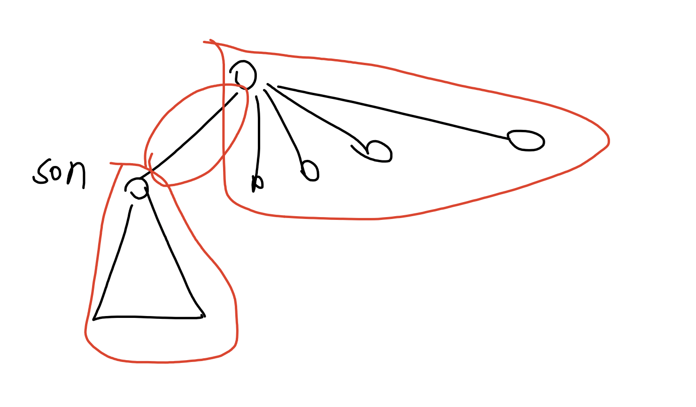

学习了下 $dpp$，T2 这种细节题我觉得很牛，根本不知道哪个地方 +1 -1 写少了/qd

T3 的码量也让我看到了什么是 ddp 的实力/kt

<!-- MORE -->

## T1

###  题目描述：

原题：[USACO2006 December Silver] Round Numbers

如果一个正整数的二进制表示中，$0$ 的数目不小于 $1$ 的数目，那么它就被称为「圆数」。

例如，$9$ 的二进制表示为 $1001$，其中有 $2$ 个 $0$ 与 $2$ 个 $1$。因此，$9$ 是一个「圆数」。

请你计算，区间 $[l,r]$ 中有多少个「圆数」。

对于 $100\%$ 的数据，保证：$T = 100$，$1 \le l \le r \le 2 \times 10^4$。

### 题目分析：

发现直接数位 dp 即可，设 $dp_{len,i,j}$ 表示当前在第 $i$ 位，出现过 $i$ 个 $0$，$j$ 个 $1$，加上记忆化就结束了。

### 代码：

<details>
  <summary> 点击查看代码： </summary>


  ```cpp
const int INF=1e18+7;
const int N=100;

int dp[N][N][N][2];
int l,r,a[N],len;

int dfs(int len,int sum0,int sum1,bool zero,bool lmt){
    if (len==0){
        if (zero) return 1;
        return sum0>=sum1;
    }
    if (!lmt&&dp[len][sum0][sum1][zero]!=-1) return dp[len][sum0][sum1][zero];
    int m=lmt?a[len]:1,res=0;
    for (int i=0;i<=m;i++){
        if (i==0&&zero) res+=dfs(len-1,sum0,sum1,zero,lmt&&(a[len]==i));
        else res+=dfs(len-1,sum0+(i==0),sum1+(i==1),0,lmt&&(a[len]==i));
    }
    if (!lmt) dp[len][sum0][sum1][zero]=res;
    return res;
}

int solve(int x){
    int res=x;len=0;
    while(res){
        a[++len]=res%2;
        res>>=1;
    }
    return dfs(len,0,0,1,1);
}

signed main(){
    memset(dp,-1,sizeof dp);
    int T=read();
    while(T--){
        scanf("%lld%lld",&l,&r);
        printf("%lld\n",solve(r)-solve(l-1));
    }
    return 0;
}
  ```

</details>

## T2

### 题目描述：

原题：LuoguP7596「EZEC-8」游戏蛇

小 A 和小 B 是两条蛇，他们正在一棵特殊的树上做游戏。

这棵树的结构如下：首先有一条长度为 $n$ 的链，称为“主链”。主链由 $1$ 至 $n$ 这 $n$ 个节点构成。在主链上，编号相邻的点有边相连，否则则没有。

主链上的每一个点都挂着一条链，称为“副链”。主链上的第 $i$ 个点挂的副链长度（链上的点数）为 $x_i$。

小 A 和小 B 初始时都在主链上，具体而言，小 A 的**蛇尾**在点 $a$，**蛇头**在点 $b$，小 B 的**蛇头**在点 $c$，**蛇尾**在点 $d$。满足 $1\le a<b<c<d\le n$。

他们的游戏规则如下：

- 小 A 和小 B 轮流移动，小 A 先手。
- 每条蛇移动时，他会尝试整体向某一方向移动一个节点，**但不能向原来蛇尾方向移动，也就是蛇不能倒退**。需满足移动后蛇头不得与另外一条蛇的任意部分重合。
- 当一条蛇无法移动时，游戏结束，对手获胜。

现在有 $q$ 次询问，每次询问给定 $a,b,c,d$，请求出当两条蛇都采取最优策略时，哪一条蛇会获胜。

对于 $100\%$ 的数据，$1\le n,q\le5\times10^5$，$1\le x_i\le10^9$，$1\le a<b<c<d\le n$。

### 题目分析：

对于每一个 $i$，假设 A 会在 $i$ 这个位置进洞，怎样才能获得胜利？

1. B 不管选择左边的任何一个点进洞，都比 $x_i$ 大。
2. B 跟在 A 后面，要是让 B 随着 A 进洞，那 A 必败，考虑如何必胜，其实就是让自己还没完全进洞之前，B 就不得不 $\le i$ 这个位置即可，那就说明 B 一定寄了。

---

先考虑 $2$ 操作，A 完全进入的 $i$ 这个洞的时间为 $i-b+(b-a)=i-a$，那么 B 这个时候应该在 $c-(i-a)$ 的位置，但是需要保证 $B\le i$，所以 $c-(i-a)\le i$，即 $i\ge \frac{c+a}{2}$，也就是说，A 想要胜利，选择的位置一定在 $[\max(b,\frac{c+a}{2}),\frac{b+c}{2}]$。

---

然后考虑 $1$ 操作，假设 B 在 $j$ 这个位置，如果存在一个 $mid(mid\in(i,j])$ 使得 $(j-mid)+x_{mid}\ge x_i$，那么 A 就会失败，我们可以找到右边最大的一个 $\max((j-mid)+x_{mid})$，$j$ 具有单调性，所以我们可以去找到最大的 $j$，如果 $j$ 在 B 的右侧，那么 A 必胜。

维护 $x_{mid}-mid$，找到 $x_{mid}-mid+j< x_i$ 的 $j$ 的最大位置，如果 B 位于 $j$ 的左边，那么 A 必胜，那么我们可以找到一个 $L_i$ 表示 A 在 $i$ 这个位置进洞，B 位于 $(i,L_i]$ 时，A 必胜。

其实这个位置就是上面说的最小位置 $-1$ 好像。

统计 $L$ 的时候，想要 $x_i$ 比所有的 $x_{mid}-mid+j$ 全都比 $x_i$ 小，考虑去二分一个 B 所在的位置，然后要保证在 $i+1\sim j$ 中的最大值 $+j < x_i$。

---

考虑判定胜负的方法：谁先进入一个进入就必胜的洞，谁就胜利，所以对于 A，找到大于 $b$ 必胜的洞，依旧采用二分，可以进入的洞的区间为 $[\max(b,\frac{c+a}{2}),\frac{b+c}{2}]$，我们要检验在 $[\max(b,\frac{c+a}{2}),mid]$ 中是否有一个位置 $i$，让 A 必胜，也就是当 A 到达 $i$ 时，B 的位置应该在 $c-(i-b)$，要保证 B 的位置在 $L_i$ 的左侧， 即 $c-i+b\le L_i$，也就是 $c+b\le L_i+i$，可以用个 st 表来存 $L_i+i$，每次找到最大值，使得他 $\ge c+b$。	

这里可以用二分 $i$，找到最小的合法的 $i$。

对于 B 同理，只不过需要注意一下先手和后手的区别。

### 代码：

<details>
  <summary> 点击查看代码： </summary>


  ```cpp
const int INF=1e9+7;
const int N=1e6+7;

int st[26][N],st2[26][N];
int x[N],n,q,L[N],R[N];
int pw[26],lg2[N];

int get(int l,int r){
    if (l>r) return -INF;
    int len=lg2[r-l+1];
    return max(st[len][l],st[len][r-pw[len]+1]);
}

int get2(int l,int r){
    if (l>r) return INF;
    int len=lg2[r-l+1];
    return min(st2[len][l],st2[len][r-pw[len]+1]);
}

void solve1(){//先手
    for (int i=1;i<=n;i++) st[0][i]=x[i]-i;
    for (int j=1;j<=24;j++){
        for (int i=1;i+pw[j-1]-1<=n;i++){
            st[j][i]=max(st[j-1][i],st[j-1][i+pw[j-1]]);
        }
    }
    for (int i=1;i<=n;i++){
        int l=i+1,r=n;L[i]=-INF;
        while(l<=r){
            int mid=(l+r)>>1;
            if (get(i+1,mid)+mid<x[i]) L[i]=mid,l=mid+1;
            else r=mid-1;
        }
    }
}

void solve2(){//后手
    for (int i=1;i<=n;i++) st[0][i]=x[i]+i;
    for (int j=1;j<=24;j++){
        for (int i=1;i+pw[j-1]-1<=n;i++){
            st[j][i]=max(st[j-1][i],st[j-1][i+pw[j-1]]);
        }
    }
    for (int i=1;i<=n;i++){
        int l=1,r=i-1;R[i]=INF;
        while(l<=r){
            int mid=(l+r)>>1;
            if (get(mid,i-1)-mid<x[i]) R[i]=mid,r=mid-1;
            else l=mid+1;
        }
    }
}

signed main(){
    scanf("%d%d",&n,&q);
    for (int i=1;i<=n;i++) x[i]=read();
    for (int i=0;i<=25;i++) pw[i]=(1<<i);
    for (int i=1;i<=n;i++) lg2[i]=log2(i);
    solve1();
    solve2();
    for (int i=1;i<=n;i++){
        st[0][i]=L[i]+i;
        st2[0][i]=R[i]+i;
    }
    for (int j=1;j<=24;j++){
        for (int i=1;i+pw[j-1]-1<=n;i++){
            st[j][i]=max(st[j-1][i],st[j-1][i+pw[j-1]]);
            st2[j][i]=min(st2[j-1][i],st2[j-1][i+pw[j-1]]);
        }
    }
    while(q--){
        int a=read(),b=read(),c=read(),d=read();
        // 找到最小的洞，让 A 必胜
        int L0=max(b,(c+a+1)/2),l=L0,r=(b+c)/2,posa=INF;
        while(l<=r){
            int mid=(l+r)>>1;
            if (get(L0,mid)>=c+b) posa=mid,r=mid-1;
            else l=mid+1;
        }
        // 找到最大的洞，让 B 必胜
        int R0=min(c,(b+d+1)/2),posb=-INF;
        r=R0,l=(b+c)/2+1;
        while(l<=r){
            int mid=(l+r)>>1;
            if (get2(mid,R0)<=b+c+1) posb=mid,l=mid+1;
            else r=mid-1;
        }
        if (posa!=INF&&(posa-b<=c-posb||posb==-INF)) printf("A\n");
        else if (posb!=-INF&&(posa-b>c-posb||posa==INF)) printf("B\n");
        else{
            if ((b+c)&1) printf("B\n");
            else printf("A\n");
        }
    }
    return 0;
}
  ```

</details>

## T3

### 题目描述：

一张图上有编号从 $0$ 开始的 $n+1$ 个点和 $n+m$ 条边。这 $n+m$ 条边中有 $n$ 条是连接 $(0,i)$ 的边，权值为 $a_i$，有 $m$ 条是连接 $(u_i,v_i)$ 的边，权值为 $w_i$。

$q$ 次修改，每次将 $a_x$ 变成 $y$，求每次修改后图的最小生成树，注意修改之间并不独立，也就是说会保留每次修改对原图的影响。

对于 $100\%$ 的数据，保证：$1\le n,m,q \le 3 \times 10^5$。

### 题目分析：

如果没有点 $0$，那我们在剩下的图中求最小生成树，就是答案，但是有 $0$ 之后，你发现需要舍弃一部分边，然后让他连向 $0$ 就好了，这个东西直接做很难做，但是你可以设个 $dp_{i,0/1}$ 表示已经考虑完了 $i$ 子树，并且整个子树联通，当前是否和 $0$ 联通的最小权值。

转移可以随手推一推：
$$
dp_{u,0}=\min(dp_{u,0}+dp_{v,1},dp_{u,0}+dp_{v,0}+w(u,v))\\\\
dp_{u,1}=\min(dp_{u,0}+dp_{v,1}+w(u,v),dp_{u,1}+\min(dp_{v,1},dp_{v,0}+w(u,v))
$$
可以发现是一个 $\text{min+}$ 的形式，也就是说符合结合律，而且待修改还是 $dp$，很容易想到这个题可以用 $ddp$ 即动态 $dp$ 来做，一般 $ddp$ 都会用矩阵来做，因为用线段树好维护。

这里推荐一个非常好写的矩阵转移：

$a[0][0]$ 可以看作是从 $0$ 状态转移到 $0$ 状态，同理 $a[0][1]$ 可以看作是 $0$ 状态转移到 $1$ 状态，这样你会发现不用写非常繁琐的推导，而且他还是对的。

发现 $dp$ 的一次修改，只会影响到从他开始到根的 $dp$ 值，但是这样复杂度也可能是 $O(n)$ 的，所以我们对整个树做树剖，这样不仅可以用线段树快速维护每一条链，而且每次修改只会影响 $\log n$ 个轻链，这样一次修改的复杂度就变成 $O(n\log^2 n)$。

接下来每个点我们把他分成重儿子和轻儿子考虑，轻儿子的矩阵可以用另外一颗线段树来维护，这个是简单的，那么整个图就会被分割成三个部分：



因为重儿子还需要和他的父亲进行转移，而轻儿子直接用上面的 $dp$ 转移即可。

重儿子也可以推一下（设 $g$ 是最右边部分的轻儿子已经处理完的答案）：
$$
\min(g_{u,1}+dp_{son,0}+w(u,son),g_{u,0}+dp_{son,1}) \to dp_{u,0}\\\\
\min(g_{u,0}+dp_{son,1}+w(u,son),g_{i,1}+\min(dp_{son,0}+a_{son},dp_{son,1})) \to dp_{u,1}
$$
剩下的第三个部分，也就是 $son$ 和 $u$ 的合并，这个东西要依据题目而定。

剩下的就是一些模版了。

### 代码：

<details>
  <summary> 点击查看代码： </summary>


  ```cpp
const int INF=1e18+7;
const int N=3e5+7;

int n,m,Q;
int dfn[N],cnt,id[N],top[N],ed[N],fa[N],sz[N];
int son[N];
int val[N],a[N];//val[i] 表示父亲到 i 的路径权值

int pos[N];//pos 表示当前是父亲的第几个儿子
int rt[N],tot;// 第 i 个节点的根
vector<int> s[N];//记录一个点的儿子有哪些

vector<PII> G[N];
struct node{
    int a[3][3];
    node operator * (const node& b)const{
        node c;
        c.a[0][0]=min(a[0][0]+b.a[0][0],a[0][1]+b.a[1][0]);
        c.a[0][1]=min(a[0][0]+b.a[0][1],a[0][1]+b.a[1][1]);
        c.a[1][0]=min(a[1][0]+b.a[0][0],a[1][1]+b.a[1][0]);
        c.a[1][1]=min(a[1][0]+b.a[0][1],a[1][1]+b.a[1][1]);
        return c;
    }
}t[N<<2],t_son[N<<3],f[N],e;//e 表示单位元

namespace Kru{
    int fa[N];
    bool vis[N];
    struct node{
        int u,v,w;
        bool operator < (const node a) const{
            return w<a.w;
        }
    }e[N];
    int find(int x){
        if (x==fa[x]) return x;
        return fa[x]=find(fa[x]);
    }
    void Main(){
        n=read(),m=read();
        for (int i=1;i<=n;i++) a[i]=read();
        for (int i=1;i<=m;i++){
            e[i].u=read(),e[i].v=read();e[i].w=read();
        }
        for (int i=1;i<=n;i++) fa[i]=i;
        sort(e+1,e+m+1);
        for (int i=1;i<=m;i++){
            int x=find(e[i].u),y=find(e[i].v);
            if (x==y) continue;
            fa[x]=y;
            G[e[i].u].p_b({e[i].v,e[i].w});
            G[e[i].v].p_b({e[i].u,e[i].w});
        }
        int lst=0;
        for (int i=1;i<=n;i++){
            int x=find(i);
            if (!vis[x]){
                vis[x]=1;
                if (lst){
                    G[lst].p_b({x,INF});
                    G[x].p_b({lst,INF});
                }
                lst=x;
            }
        }
    }
}

namespace SG_son{//轻儿子的
    int ls[N<<3],rs[N<<3];
    void pushup(int p){
        t_son[p]=t_son[ls[p]]*t_son[rs[p]];
    }
    void build(int l,int r,int &p,int RT){
        if (l>r) return;
        p=++tot;
        if (l==r){
            int v=s[RT][l];
            if (l==0){
                t_son[p].a[0][0]=val[v];
                t_son[p].a[0][1]=val[v]+a[RT];
                t_son[p].a[1][0]=0;
                t_son[p].a[1][1]=min(val[v],a[RT]);
            }
            else{
                t_son[p].a[0][0]=min(f[v].a[0][1],f[v].a[0][0]+val[v]);
                t_son[p].a[0][1]=f[v].a[0][1]+val[v];
                t_son[p].a[1][0]=INF;
                t_son[p].a[1][1]=min(f[v].a[0][1],f[v].a[0][0]+val[v]);
            }
            return;
        }
        int mid=(l+r)>>1;
        build(l,mid,ls[p],RT);build(mid+1,r,rs[p],RT);
        pushup(p);
    }
    void modify(int pos,int l,int r,int p,int RT){
        if (l>r) return;
        if (l==r){
            int v=s[RT][l];
            if (l==0){
                t_son[p].a[0][0]=val[v];
                t_son[p].a[0][1]=val[v]+a[RT];
                t_son[p].a[1][0]=0;
                t_son[p].a[1][1]=min(val[v],a[RT]);
            }
            else{
                t_son[p].a[0][0]=min(f[v].a[0][1],f[v].a[0][0]+val[v]);
                t_son[p].a[0][1]=f[v].a[0][1]+val[v];
                t_son[p].a[1][0]=INF;
                t_son[p].a[1][1]=min(f[v].a[0][1],f[v].a[0][0]+val[v]);
            }
            return;
        }
        int mid=(l+r)>>1;
        if (pos<=mid) modify(pos,l,mid,ls[p],RT);
        else modify(pos,mid+1,r,rs[p],RT);
        pushup(p);
    }
};

namespace SG1{//链的
    void pushup(int p){
        t[p]=t[rs(p)]*t[ls(p)];
    }
    void build(int l,int r,int p){
        if (l>r) return;
        if (l==r){
            int x=id[l];
            if (s[x].size()==0) t[p]=e;
            else t[p]=t_son[rt[x]];
            return;
        }
        int mid=(l+r)>>1;
        build(l,mid,ls(p));
        build(mid+1,r,rs(p));
        pushup(p);
    }
    void modify(int pos,int l,int r,int p){
        if (l>r) return;
        if (l==r){
            int x=id[l];
            t[p]=t_son[rt[x]];
            return;
        }
        int mid=(l+r)>>1;
        if (pos<=mid) modify(pos,l,mid,ls(p));
        else modify(pos,mid+1,r,rs(p));
        pushup(p);
    }
    node query(int ql,int qr,int l,int r,int p){
        if (ql>qr) return e;
        if (ql<=l&&qr>=r) return t[p];
        int mid=(l+r)>>1;
        if (qr<=mid) return query(ql,qr,l,mid,ls(p));
        if (ql>mid) return query(ql,qr,mid+1,r,rs(p));
        return query(ql,qr,mid+1,r,rs(p))*query(ql,qr,l,mid,ls(p));
    }
}using namespace SG1;

void update(int u,int val){
    a[u]=val;
    if (s[u].size()==0){
        f[u].a[0][0]=0,f[u].a[0][1]=a[u];
    }
    else{
        SG_son::modify(0,0,s[u].size()-1,rt[u],u);
        modify(dfn[u],1,n,1);
    }
    while(top[u]){
        int ftop=fa[top[u]];
        f[top[u]]=f[id[ed[top[u]]]]*query(dfn[top[u]],ed[top[u]]-1,1,n,1);
        if (ftop){
            SG_son::modify(pos[top[u]],0,s[ftop].size()-1,rt[ftop],ftop);
            modify(dfn[ftop],1,n,1);
            f[ftop]=f[son[u]]*t_son[rt[ftop]];
        }
        u=ftop;
    }
}

void dfs1(int u,int fath){
    int siz=0;
    fa[u]=fath;sz[u]=1;
    for (auto s:G[u]){
        int v=s.fi,w=s.se;
        if (v==fath) continue;
        val[v]=w;
        dfs1(v,u);sz[u]+=sz[v];
        if (sz[v]>sz[son[u]]) son[u]=v;
    }
    if (son[u]) s[u].p_b(son[u]);
    for (auto _:G[u]){
        int v=_.fi;
        if (v==fath||v==son[u]) continue;
        pos[v]=++siz;s[u].p_b(v);
    }
    if (s[u].size()==0){
        f[u].a[0][0]=0,f[u].a[0][1]=a[u];
        rt[u]=++tot;t_son[rt[u]]=e;
    }
    else{
        SG_son::build(0,s[u].size()-1,rt[u],u);
        f[u]=f[son[u]]*t_son[rt[u]];
    }
}

void dfs2(int u,int topp){
    dfn[u]=++cnt;id[cnt]=u;
    top[u]=topp,ed[topp]=cnt;
    if (son[u]) dfs2(son[u],topp);
    for (auto s:G[u]){
        int v=s.fi,w=s.se;
        if (v==fa[u]||v==son[u]) continue;
        dfs2(v,v);
    }
}

signed main(){
    Kru::Main();
    e.a[0][0]=e.a[1][1]=0;
    e.a[0][1]=e.a[1][0]=INF;
    dfs1(1,0),dfs2(1,1);
    build(1,n,1);
    Q=read();
    while(Q--){
        int x=read(),y=read();
        update(x,y);
        printf("%lld\n",f[1].a[0][1]);
    }
    cerr<<TIME<<" ms\n";
    return 0;
}
  ```

</details>

## T4

[题目链接](https://loj.ac/p/3190)

会不了一点。

