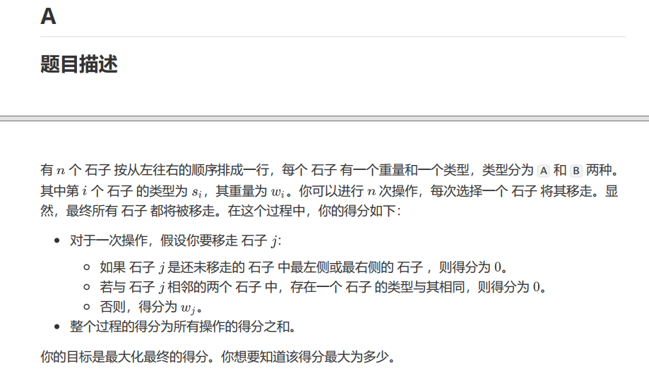
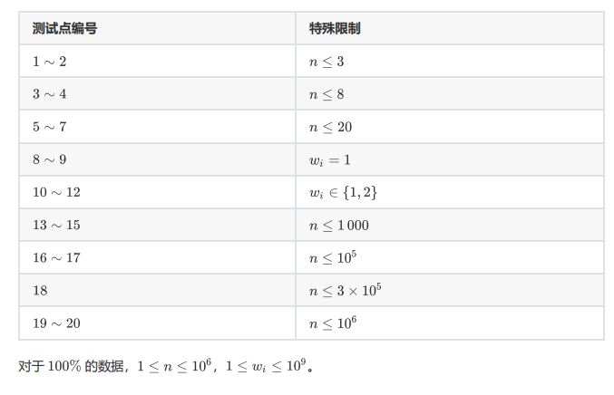
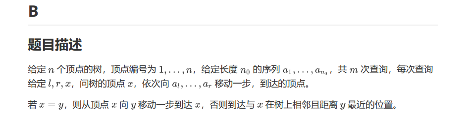
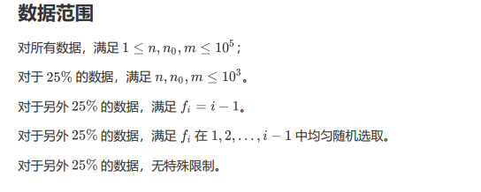
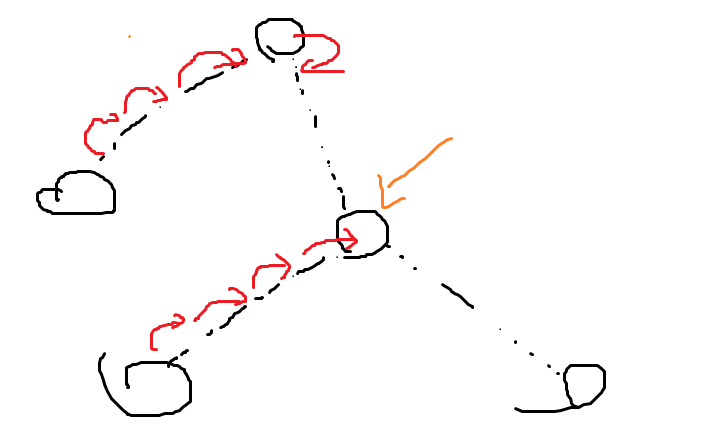

<!-- MORE -->

update on 4月17 现在是 day11 的晚上 $21:17$ 补题解的时候发现自己真的好菜，最先开始都是 $70$ 或者 $80$ 名，到了后面几天，一般都是 $50$ 或者 $60$ 名，甚至有几次差点进了 $30$ （可恶的挂分，我算了算 $12$ 天起码挂了 $100$）

## day0
4.16从一北出发，去平邑一中，psq 爸爸走的时候忘记带我们了，到了半路又回来的，最后 5 点多才到平邑，wlw 给我说他想单间（单间一天220多），不过看到价格后，又换成双人间了（主要原因是我们只有在晚上在酒店，所以互相打扰的因素就几乎没有了），发现曼兹比全季一天便宜 20 （还有他们说全季==全寄），于是我们去了曼兹

看了一会数学，6点多了，坐上公交车去平邑一中吃饭+试机

愉快的一晚上就过完了

## day1
day1 就寄了

T1 好像是个和经典的题，大家都会，但是我不是很会，成倒数的了/kk

考试时候的分数：35+5+30
成功垫底，79 th

### T1

十分的 $sb$ 但是就我打完了状压的暴力就跑路了，只拿了 $35$ 分





首先想到的是，如果一堆 $A$ 连在一起，那么这一堆数里面，只能一个石头可以取到值，所以我们取一个连续类型区间的最大值，代替这个区间。

所以可以把一个序列修改成 $ABABABA....$ 这样的形式

所以现在就是给一个区间，每次取一个数，如果在最左边或者是最右边，则没有权值，如果左边和右边分别有一个和自己的类型相同，那就没有权值。

手膜一下可以发现，我们取一个数，一定会有 $1$ 个数没有权值，那现在的问题就是我们可以取多少个数

首先左边和右边的数字肯定留到最后再取且一定没有权值，这个时候最优，而且剩下的点每两个点中可以取一个

假设一共有 $n$ 个数，所以我们可以取 $(n-2)/2$

但是还有一个问题，如果有 $BAB$ 则我们可以取走一个

也就是说我们需要上取整

```cpp
// 35 分的 sb 状压暴力
#include<bits/stdc++.h>

#define fi first
#define se second
#define int long long
#define m_p make_pair
#define p_b push_back
#define PII pair<int,int>
#define all(x) x.begin(),x.end()
using namespace std;

const int N=1<<21;
const int INF=1e9+7;

int n,w[N],f[N];
char s[N];

void put(int x)
{
	while(x)
	{
		printf("%lld",x%2);
		x/=2;
	}
}

signed main()
{
//	freopen("a.in","r",stdin);
//	freopen("a.out","w",stdout);
	scanf("%lld%s",&n,s);
	for (int i=0;i<n;i++) scanf("%lld",&w[i]);
	for (int i=0;i<(1<<n);i++)
	{
		for (int j=0;j<n;j++)
		{
			if (!((i>>j)&1))
			{
				f[i+(1<<j)]=max(f[i+(1<<j)],f[i]);
				bool flag=0;
				for (int z=j+1;z<n;z++)
					if (!((i>>z)&1)) flag=1;
				if (flag==0) continue;
				flag=0;
				for (int z=0;z<j;z++)
					if (!((i>>z)&1)) flag=1;
				if (flag==0) continue;
				if (flag)
				{
					int ll,rr;
					for (int z=j+1;z<n;z++)
						if (!((i>>z)&1))
						{
							rr=z;
							break;
						}
					for (int z=j-1;z>=0;z--)
						if (!((i>>z)&1))
						{
							ll=z;
							break;
						}
					f[i+(1<<j)]=max(f[i+(1<<j)],f[i]+w[j]*(s[ll]!=s[j]&&s[rr]!=s[j]));
				}
			}
		}
	}
	int x=(1<<n)-1;
	int ans=f[x];
	printf("%lld\n",ans);
	return 0;
}
```

以下是正解：
```cpp
#include<bits/stdc++.h>

#define fi first
#define se second
#define int long long
#define m_p make_pair
#define p_b push_back
#define PII pair<int,int>
#define all(x) x.begin(),x.end()
using namespace std;

const int N=2e6+7;
const int INF=1e9+7;

int n,a[N],w[N];
char s[N];

bool cmp(int a,int b)
{
	return a>b;
}

signed main()
{
	scanf("%lld",&n);
	scanf("%s",s+1);
	for (int i=1;i<=n;i++) scanf("%lld",&w[i]);
	int cnt=0;
	for (int i=1;i<=n;i++)
	{
		int j;
		for (j=i;j<=n;j++) if (s[i]!=s[j+1]) break;
		int mx=0;
		for (int k=i;k<=j;k++) mx=max(mx,w[k]);
		a[++cnt]=mx;
		i=j;
	}
	a[1]=a[cnt]=0;
	sort(a+1,a+cnt+1,cmp);
	int ans=0;
	for (int i=1;i<=(cnt-2+1)/2;i++) ans+=a[i];
	printf("%lld",ans);
	return 0;
}

```

### T2

这个题非常的神仙，是个分块、虚树（因为虚树我不是很会，所以现在不怎么会补）





首先进行分块，从 $l$ 到 $r$ 就是经过了一段区间，从 $x$ 变成了 $f(x)$ 然后输出这个 $f(x)$ 

然后不在块内的就暴力跑，在块内的，我们每个块建立一个虚树

这个虚树是原树上所有的点建立的虚树



假设当前的点是黄色的点，那也就是说虚边上的点，都要像红色的一样像橙色的点移动，然后会有三个点都转移到橙色的点对吧，那我们不可能在每个点上建立一个 vector 这样会非常的炸空间，所以我们考虑在每一个点上搞一个链表，所以每一次操作都是 $O(1)$ 的

而还有非树边，其实每一个非树边距离第一次到树上的时候是确定的，所以我们直接计算出来就OK了

到这里我差不多就掉线了，很多都是糊上的，太菜了，不会写，所以先摆着吧

### T3
T3 就更不用说了，我现在已经忘干净当时讲了啥了，放个题目吧


## day2

day2 是真的倒数，0+0+25 T1 T2 暴力都打崩了，95 th

我觉得其实不是因为我的水平问题，是因为平常做题都是照着题解的代码学，所以自己打的时候就会出现 sb 问题，还是要多尝试自己做题自己调题

day2 虽然也很寄，但是出的题非常的好，T1 和 T2 我都会了，而且最后竟然没有给我扣 rating（开森）

先写了 T1 结果 T1 的 dfs 我写的很寄，直接写了三个小时，导致别的暴力都没打多少 T1 也没分

T3 也比较气人，我本来就想写个线段树骗点暴力分，结果忘记把预处理的 $\log$ 提出来了，结果同桌提出来的 $50$ 分，我 $25$ ，下午改了一下，发现自己的代码常数有点大，就只有 $30$

### T1


读完题目，感觉可做，但是想了半天直接开始打暴力

打了几乎三个小时的暴力，最后也没打出来

其实在打的过程中我想过从两个点开始去跑，如果两个点能跑到两个相同的点，那也可以形成环，但是显然很难打，我也不想打

后来又想到了一个，我从第一个点开始跑 $bfs$ ，所以剩下的横叉边就会形成很多环，不过情况有点多，我又摆烂了，不想打，于是 $T1$ 寄。

说一下正解：

首先跑 $bfs$ ，我们跑到了第 $i$ 层，思考一下怎么可以形成环

有两种情况：


第一种统计答案其实很简单，就是每个点可以到达的点，并且和自己在同一层，就可以形成环，但其实是有问题的，因为每两个点会分别被两个点统计一次答案，所以要除以 $2$，但是我们还需要更新环的大小，其实非常简单，假设 $i$ 到 $1$ 的距离是 $L$ 那么这个环的大小就是 $L*2+1$

第二种其实也很简单，不过这里提供一种比较好统计答案的方法

我们找到一个 $i+1$ 层的点，去找 $i$ 层的点并且和他有边相连

假设有 $n$ 个点，那答案就是两两互相匹配，也就是 $n\times(n-1)/2$

这里我们也需要更新环的大小，其实非常简单，假设 $i$ 到 $1$ 的距离是 $L$ 那么这个环的大小就是 $L*2+2$

这就是两种可能（听完之后发现这题真的好 $sb$ 啊）

但是还有一个问题，如果出现这样的问题，我们统计的答案不会出现问题吗？如下：


我们统计的环的大小显然比真实的环大 1，但是实际上这个环我们根本就不会统计到，因为这个环的大小显然不会影响答案的取值，因为答案是求最小值

```cpp
#include<bits/stdc++.h>

#define fi first
#define se second
#define int long long
#define m_p make_pair
#define p_b push_back
#define PII pair<int,int>
#define all(x) x.begin(),x.end()
using namespace std;

const int N=3e3+7;
const int INF=1e9+7;

int n,m,vis[N],cnt;
int ans=INF,head[N],res=0;
vector<int> g[N];
struct node{
	int v,nxt;
}e[12007];

void add(int u,int v)
{
	e[++cnt].v=v;
	e[cnt].nxt=head[u];
	head[u]=cnt;
}

void bfs(int S)
{
	queue<int> q;
	q.push(S);
	for (int i=0;i<=n;i++) g[i].clear();
	for (int i=1;i<=n;i++) vis[i]=-1;
	g[0].p_b(S),vis[S]=0;
	while(!q.empty())
	{
		int u=q.front();q.pop();
		for (int i=head[u];i;i=e[i].nxt)
		{
			int v=e[i].v;
			if (vis[v]==-1)
			{
				vis[v]=vis[u]+1;
				g[vis[v]].p_b(v); 
				q.push(v);
			}
		}
	}
	for (int i=1;i<=n;i++)
	{
		if (i>1)
		{
			int num=0;
			for (int k=0;k<g[i].size();k++)
			{
				int u=g[i][k],now=0;
				for (int j=head[u];j;j=e[j].nxt)
				{
					int v=e[j].v;
					if (vis[v]==i-1) now++;
				}
				num+=now*(now-1)/2;
			}
			if (num>0)
			{
				if (ans>2*i) ans=2*i,res=num;
				else if (ans==2*i) res+=num;
				return;
			}
		}
		int num=0;
		for (int k=0;k<g[i].size();k++)
		{
			int u=g[i][k];
			for (int j=head[u];j;j=e[j].nxt)
			{
				int v=e[j].v;
				if (vis[v]==i) num++;
			}
		}
		num/=2;
		if (num>0)
		{
			if (ans>i*2+1) ans=i*2+1,res=num; 
			else if (ans==i*2+1) res+=num;
			return;
		}
	}
}

signed main()
{
	scanf("%lld%lld",&n,&m);
	for (int i=1;i<=m;i++)
	{
		int x,y;
		scanf("%lld%lld",&x,&y);
		add(x,y);
		add(y,x);
	}
	for (int i=1;i<=n;i++) bfs(i);
	printf("%lld",res/ans);
	return 0;
}
```

### T2


因为 T1 没打出来暴力，所以第一次读题的时候把子序列读成了子串，导致浪费了一些时间

但是 T1 没打出来，同桌已经打出来了，所以我就开始慌了，就没想

一考完冷静下来，直接就能想到 $dp$ 啊

我们直接说正解吧：

首先我们按照 $i$ 把序列分成好几块，我们设 $f[i][j][k]$ 表示选择的第一个字母是 $i$，并且用 $i$ 来分割区间，选择的第二个字母是 $j$ ，当前的块是第 $k$ 块

每个块中只能选一个 $j$ ，所以我们只需要判断这一段有没有 $j$ 这个字母就可以了

于是发现转移非常的简单：$f[i][j][k]+=f[i][j][k-1]$

剩下还有初始化和答案的统计

首先初始化比较简单，我们只需要统计每一块里面有没有出现过 $j$ ，可以先搞一个 $sum[26][N]$ 来表示 i 这个字符在 n 中出现的位置，接着前缀和一下（可能听着比较玄乎，看一下代码就行了），如果说 $i$ 出现的位置的 $sum[j]$ 减去上一个 $j$ 出现的位置，如果次数 $>1$ 那么 $f[i][j].p\_b(1)$

统计答案其实更简单，枚举一个 $i,j$ 然后通过 $suf$ 和 $pre$ 来找到 $i$ 在 $l$ 后出现的第一个位置和 $i$ 在 $r$ 前出现的位置，那么答案就是 $(f[i][j][rr]-f[i][j][ll])\times 2-1$

但是还少一点东西，就是如果在 $rr$ 之后如果还有一个 $j$ 那么答案还可以 $+1$ ，所以就判断一下 $sum[r][j]-sum[pos[i][rr]][j]$ 是否大于 $0$ 即可，如果大于 $0$ 那么答案加一，最后枚举完之后在所有的答案中去个 max

lxl 实在是太狠了，我卡了半天常数没卡过去，$90$ 分也不想调了，摆烂

```cpp
#include<bits/stdc++.h>

#define fi first
#define se second
#define LL long long
#define m_p make_pair
#define p_b push_back
#define PII pair<int,int>
#define all(x) x.begin(),x.end()
using namespace std;

const int N=1500000+7;
const int INF=1e9+7;

int n,m,sum[N][27],pre[27][N],suf[27][N];
vector<int> f[27][27];
vector<int> pos[27];
char s[N];

int main()
{
	scanf("%s",s+1);
	n=strlen(s+1);
	for (int i=1;i<=n;i++)
	{
		for (int j=1;j<=26;j++)
			sum[i][j]=sum[i-1][j];
		sum[i][s[i]-'a'+1]++;
		pos[s[i]-'a'+1].p_b(i);
	}
	for (int i=1;i<=26;i++) pos[i].p_b(n+1);
	int lst=1;
	for (int i=1;i<=26;i++)
	{
		for (int j=1;j<=26;j++)
		{
			if (i==j) continue;
			for (auto k:pos[i])
			{
				if (sum[k][j]-sum[lst-1][j]>0) f[i][j].p_b(1);
				else f[i][j].p_b(0);
				lst=k+1;
			}
			for (int k=1;k<(int)f[i][j].size();k++)
				f[i][j][k]+=f[i][j][k-1];
		}
	}
	for (int i=1;i<=26;i++)
	{
		int lst=1;
		for (int k=0;k<pos[i].size();k++)
		{
			int r=pos[i][k];
			for (int j=lst;j<=r;j++) pre[i][j]=k,suf[i][j]=k+1; 
			// 从第 k-1 段到第 k 段，pre 为在 j 这个位置，前面第一个出现 i 的位置是第 k 个，这里实际上记录的是后面的第一个，但是用的时候 -1 就OK了 
			// suf 为在 j 这个位置，后面第二个出现的 i 的位置是第 k+1 个 ，这里实际上记录的是后面的第二个，用的时候 -1 就OK了 
			lst=r;
		}
		for (int k=0;k<(int)pos[i].size();k++) pre[i][pos[i][k]]=suf[i][pos[i][k]]=k+1;
	}
	scanf("%d",&m);
	while(m--)
	{
		int l,r;
		scanf("%d%d",&l,&r);
		int ans=0,ans1=0,ans2=0;
		for (int i=1;i<=26;i++)
		{
			for (int j=1;j<=26;j++)
			{
				if (i==j) continue;
				int tmp=0;
				int ll=suf[i][l]-1,rr=pre[i][r]-1;
				if (ll<=rr)
				{
					tmp=1+(f[i][j][rr]-f[i][j][ll])*2;
					if (sum[r][j]-sum[pos[i][rr]][j]>0) tmp++;
				}
				if (tmp>ans)
				{
					ans=tmp;
					ans1=i,ans2=j;
				}
			}
		}
		printf("%d %c%c\n",ans,ans1+'a'-1,ans2+'a'-1);
	}
	return 0;
}
```

### T3
咕咕咕，不是很会，就贴个题目吧


## day3
十分刺激的一天！！！并且也是前几天里最有趣的一天！！

早上迷迷糊糊的躺在床上，感觉今天起的好像比平常晚？

于是瞄了眼闹钟，$7:17$ wc我们 $7:20$ 发车，wlw 直接被我搞醒了，然后我俩就飞快的取眼镜（塑性镜），他穿衣服快，就先下去了，我赶紧换了身凉快点的衣服，因为那天挺热的，然后上了电梯，竟然在电梯里愣了差不多 $10s$ 忘记点 $1$ 层的电梯了，下了楼之后，发现外面也没有车，wlw 也不见了

我直接就以为 wlw 坐上车结果忘给司机说我还没走，然后我就急忙朝着平成车开始走的地方跑了差不多半个路口，想看看是不是才走不久，但是到了路口，我就停下了，等了差不多 $3min$ ，想看看还有没有可能车回来接我，是我想多了，我当时就站在那里傻了(俗话说 $CPU$ 烧了) ，一时之间不知道要去哪里，于是就跑回了曼兹酒店，让前台给教练打个电话，结果他找不到教练住酒店时的电话了，然后他就说开始带我走吧，我直接就开心！！（现在的酒店别说都真的很贴心）

差不多 $37$ 到了 pyyz 的大门口，我跑着去了食堂，以为 wlw 和 psq 应该快吃完了，没想到就 psq 一个人坐在那里，我问他 wlw 没来吗？结果真没来，心想坏了，他不会要走过来吧。。

等着吃完饭，wlw 正好刚到学校，没想到他是走了半路，找了个三轮车来的（那个三轮车的人也挺善良的，没有收钱），这就是早上非常好玩的事。

所以算是攒 $rp$ 了吧，接着看下题，day3 的题非常的好，我也补了两道，而且青鱼不会出数据，暴力老哥（打暴力的人）直接上大分

分数：46+25+30 因为暴力冲过去了好多点，我就涨了不少分，最后是 50th

### T1


当我看到性质 A 的时候，我就知道 dfs 一定可以拿很多分（其实最后拿了 $46$ 分好像

观察题意，最暴力其实是枚举一个点，直接把经过的每一个点都记录一下，当再向下走全都是走过的点的时候，看看所有的点是不是都走过了

因为是哈密顿路径所有的点都经过过，也就是说我们固定一个点，看一下这个点能不能到达其他的两个点，并且所有的点都经过过，就可以了，到这里其实就已经切完了。。~~但是我这个 fw 考场上光想着打暴力了~~

下面这个代码的实现挺精妙的（选的固定的点是 $n$）
```cpp
#include<bits/stdc++.h>

#define fi first
#define se second
#define LL long long
#define m_p make_pair
#define p_b push_back
#define PII pair<int,int>
#define all(x) x.begin(),x.end()
using namespace std;

const int N=30*30*2+7;
const int INF=1e9+7;

struct node{
	int v,nxt;
}e[N];

int cnt,head[N],n,a[30][30],f=0;
char s[30];

void add(int u,int v)
{
	e[++cnt].v=v;
	e[cnt].nxt=head[u];
	head[u]=cnt;
}

void dfs(int u,int gu)
{
	if (((f>>u)&1)) return;
	f+=(1<<u);
	if (f==((1<<n)-1))
	{
		a[gu][u]=1;
		f-=(1<<u);
		return;
	}
	for (int i=head[u];i;i=e[i].nxt)
	{
		int v=e[i].v;
		if (((f>>v)&1)) continue;
		dfs(v,gu);
	}
	f-=(1<<u);
}

int main()
{
//	freopen("hamilton.in","r",stdin);
//	freopen("hamilton.out","w",stdout);
	scanf("%d",&n);
	bool flag1=1,flag2=1;
	for (int i=0;i<n;i++)
	{
		scanf("%s",s);
		for (int j=0;j<n;j++)
		{
			if (i==j) continue;
			if (s[j]!=1) flag1=0;
			if (s[j]!=0) flag2=0;
			if (s[j]=='1') add(i,j);
		}	
	}
	if (flag1)
	{
		for (int i=1;i<=n;i++)
			for (int j=1;j<=n;j++)
			{
				if (i==j) cout<<"0";
				else cout<<"1";
			}
			cout<<endl;
		return 0;
	}
	if (flag2)
	{
		for (int i=1;i<=n;i++)
			for (int j=1;j<=n;j++)
				cout<<"0";
			cout<<endl;
		return 0;
	}
	for (int i=0;i<n;i++)
		dfs(i,i);
	for (int i=0;i<n;i++)
	{
		for (int j=0;j<n;j++)
			printf("%d",a[i][j]);
		puts("");
	}
	return 0;
}
```

### T2


这个题非常的好，是一个非常非常巧妙的线段树维护函数！

首先我们理下一思路

题目也就是说我们有三种操作

1. 减法，如果说减到小于等于 $0$ 的话，那人就死了
2. 取 $min$ ，如果当前的数比 $min$ 小的话，那你也死了
3. 取 $max$ ，所谓的回血操作，一定不会死

这个时候就有一种挺经典也挺秒的转化了 （反正我没想出来）

我们画出一个二维坐标，设横坐标为进入的血量，纵坐标为出去的血量

其实也很好理解，因为经过的 $a[i]$ 的区间是不一样的，所以搞一个函数就很舒服

那这个时候我们就可以用线段树来维护了，线段树的下标就是 $a$ 的下标，权值就是出去的血量

初始状态就是一个 y=x 的一次函数，如图


当我们减去血量的时候，会有一段的血量变成负数，负数的意思就是死了


当我们取 $min$ 的时候：如果当前的值比 $min$ 小，那也死了


当我们取 $max$ 时，会是这样：


所以说可以发现我们需要维护一些值

1. min：表示如果低于 min 就会死掉，当 t 等于 1 时，min 就是减去的血量，因为如果进入的血量小于减去的，那么就减死了，当 t 等于 2 时，如果 进入的数小于 min 那么也死了，t 等于 3 时不会死
2. max：除了 2 操作，max 都是 0 ，当 t==2 时，如果进入的血量小于 max 那么直接返回取 min 的那个值就行了
3. k：只会在 t 操作中用到，当我们发现进入的血量比 min 大，比 max 大时，这个时候直接返回进入的血量减去要减得血量，k就是记录的要减的血量

因为这里我们发现 min 和 max 的操作被用到时，也需要记录 min 和 max 的值，我们可以开一个变量 v 来记录

到这里差不多就没了，还有不会的就看代码把，代码还是比较好理解的

```cpp
#include <map>
#include <set>
#include <queue>
#include <cmath>
#include <ctime>
#include <stack>
#include <random>
#include <vector>
#include <cstdio>
#include <sstream>
#include <cstdlib>
#include <iomanip>
#include <cstring>
#include <iostream>
#include <algorithm>
#include <unordered_set>
#include <unordered_map>

#define fi first
#define se second
#define int long long
#define m_p make_pair
#define p_b push_back
#define PII pair<int,int>
#define all(x) x.begin(),x.end()
using namespace std;

const int N=1e6+7;
const int INF=1e18+7;

int n,Q,H0;
int t[N],a[N];

struct Tree{
	int mn,mx;
	int v,k;
	void init(int t,int a)
	{
		if (t==1) mn=mx=a+1,v=0,k=a;
		else if (t==2) mn=v=a,mx=INF,k=0;
		else if (t==3) mn=1,mx=v=a,k=0;
	}
	int get(int x)
	{
		if (x<mn) return -1;
		if (x<mx) return v;
		return x-k;
	}
};

Tree merge(Tree x,Tree y)
{
	Tree root;
	root.mn=max(x.mn,y.mn+x.k);
	root.mx=max(x.mx,y.mx+x.k);
	root.k=x.k+y.k;
	root.v=y.get(x.get(root.mn)); // question
	return root;
}

namespace segment_tree{
	Tree tr[N*4+7];
	void build(int u,int l,int r)
	{
		if (l==r)
		{
			tr[u].init(t[r],a[r]);
			return;
		}
		int mid=(l+r)>>1;
		build(u<<1,l,mid),build(u<<1|1,mid+1,r);
		tr[u]=merge(tr[u<<1],tr[u<<1|1]);
	}
	void modify(int u,int l,int r,int p)
	{
		if (l==r) return tr[u].init(t[l],a[l]);
		int mid=(l+r)>>1;
		p<=mid?modify(u<<1,l,mid,p):modify(u<<1|1,mid+1,r,p);
		tr[u]=merge(tr[u<<1],tr[u<<1|1]);
	}
	int query(int u,int l,int r,int p,int &h)
	{
		if (r<p) return n+1;
		if (l>=p)
		{
			int v0=tr[u].get(h);
			if (~v0) return h=v0,n+1;
		}
		if (l==r) return l;
		int mid=l+r>>1;
		int lans=query(u<<1,l,mid,p,h);
		if (lans!=n+1) return lans;
		return query(u<<1|1,mid+1,r,p,h);
	}
}
using namespace segment_tree;

signed main()
{
	scanf("%lld%lld%lld",&n,&Q,&H0);
	for (int i=1;i<=n;i++)
		scanf("%lld%lld",&t[i],&a[i]);
	build(1,1,n);
	while(Q--)
	{
		int op,x;
		scanf("%lld%lld",&op,&x);
		if (op==1)
		{
			scanf("%lld%lld",&t[x],&a[x]);
			modify(1,1,n,x);
		}
		else
		{
			int h=H0;
			int p=query(1,1,n,x,h)-1;
			if (p<x) printf("-1\n");
			else printf("%lld\n",p);
		}
	}
	return 0;
}
```

### T3
T3 是个神奇的题，不是很会，先放个题目


## day4
day4 好像也寄了

分数：20+0+0 最后 58th

day4 的题挺难的，暴力也很难打，大家好像都不是很会，所以我的暴力又有面子了

### T1


T1 是个非常神仙的做法，之前从来没见过

因为我们可以发现限制的其实是两个条件，第一个是体积，第二个是质量，所以就有个非常神奇的做法，把体积当做一个长方形的底，把 质量/体积 当做长方形的高，然后按照高度从小到大排序，可以发现是这样的一个图：


那么现在我们想要得就是把全部的正方形切成面积相等的两部分

假设 v 为所有底的和

我们用 v/2 来截取一块，二分这个区间的左端点，然后就可以直接求出这个区间所截取的面积了，去和面积的一半比较大小，如果大于面积一半，那就把左端点左移，小于则反之，这样的话就可以求出两个需要截取的端点

我们截取的位置一定是小于等于 2 个的，所以正好符合题意

```cpp
#include<bits/stdc++.h>

#define fi first
#define se second
#define LL long long
#define m_p make_pair
#define p_b push_back
#define PII pair<int,int>
#define all(x) x.begin(),x.end()
using namespace std;

const int N=1e6+7;
const int INF=1e9+7;

int n,pl,pr;
double v[N],L[N],R[N],sv,sh;
bool flag[N];
struct node{
	double v,h;
	int pos;
}a[N];

bool cmp(node a,node b)
{
	return a.h<b.h;
}

double solve(double l)
{
	double r=l+(sv/2),ans=0;
	pl=0,pr=0;
	for (int i=1;i<=n;i++)
	{
		if (L[i]<=l&&l<=R[i]&&!pl) pl=i;
		if (L[i]<=r&&r<=R[i]) pr=i;
	}
	for (int i=pl+1;i<=pr-1;i++) ans+=a[i].v*a[i].h;
	if (pl!=pr)
	{
		ans+=((R[pl]-l)*a[pl].h);
		ans+=((r-L[pr])*a[pr].h);
	}
	else ans+=(r-l)*a[pl].h;
	return ans;
}

int main()
{
	int T;
	scanf("%d",&T);
	while(T--)
	{
		scanf("%d",&n);
		sv=0,sh=0;
		for (int i=1;i<=n;i++) scanf("%lf",&v[i]),sv+=v[i];
		for (int i=1;i<=n;i++)
		{
			double m;
			scanf("%lf",&m);
			sh+=m;
			a[i].h=m/v[i],a[i].v=v[i],a[i].pos=i;
		}
		sort(a+1,a+n+1,cmp);
		for (int i=1;i<=n;i++)
		{
			L[i]=R[i-1];
			R[i]=L[i]+a[i].v;
		}
		double l=0,r=sv/2;
		for (int z=1;z<=30;z++)
		{
			double mid=(l+r)/2;
			if (solve(mid)>sh/2) r=mid;
			else l=mid;
		}
		r=l+(sv/2);
		solve(l);
		printf("2\n");
		printf("%d %.9lf\n",a[pl].pos,(R[pl]-l)/a[pl].v);
		printf("%d %.9lf\n",a[pr].pos,(r-L[pr])/a[pr].v);
		for (int i=1;i<=n+2;i++) flag[i]=0;
		for (int i=pl;i<=pr;i++) flag[a[i].pos]=1;
		for (int i=1;i<=n+2;i++) printf("%d ",flag[i]);
		cout<<endl;
	}
	return 0;
}
```

### T2
T2 还没补，可能回来会补，先放个题目


### T3
T3 就更不用说了


## day5

切队收钱了，为传奇代言（


day5 因为隔壁的大佬都见过 3 4 道原题，所以就成 IOI 赛制了，反正我就见过大概一个题

最后发现就会一个题的 52 分的暴力，别的还有待提升（听说题都不错，还是要改一改的）

### A


### B


### C


这个题想了好一会，然后发现一个大佬写了个动态开点值域线段树（就是一颗值域线段树，动态开点是因为不知道怎么写成线段树的形式），于是我就去请教了一下（虽然只有 $52$ 分，但是我觉得挺有用的，因为这就是正解的一大部分，后面的我好想摆烂了，不是很会）

我们直接暴力从前向后枚举，假设当前枚举到的点的大小如图，我们只能把他移动到两个橙色的位置，那我们可以分类讨论一下，两者哪一个能对答案产生的步数更少，然后加入产生的交换的步数

1. 当我们插入到左边时，可以发现自己多走了步数，但是后来将要插入的数可以少走一步，所以减少的交换次数是原序列后面还未开始交换的大于当前点的数的个数

2. 当我们插入到右边时，发现无论是后面大于自己的和小于自己的都不能减少次数，唯一能减少的就是不用走到左边，也就是说减少的交换次数是两个橙色的距离差

不理解可以看一下图


然后就知道了我们需要维护的东西，第一个是原序列中当前点之后大于自己的数的个数，可以开个值域线段树

然后我们还需要维护上面的这个图，可以直接开成两颗值域线段树，左边一颗，右边一颗

这样我们就可以直接算出两个橙色之间的距离（可以看代码理解）

```cpp
#include<bits/stdc++.h>

#define fi first
#define se second
#define l(x) ls[x]
#define r(x) rs[x]
#define int long long
#define m_p make_pair
#define p_b push_back
#define PII pair<int,int>
#define all(x) x.begin(),x.end()
using namespace std;

const int N=5e7+7,M=5e5+7;
const int INF=1e9+7;

int rt0,rt1,rt2,snt,maxnow;
int ls[N],rs[N],sz[N];
int a[M],big[M],n,_n,t;
int ans=0;

void pushup(int x)
{
	sz[x]=sz[l(x)]+sz[r(x)];
}

void ins(int x,int l,int r,int &d)
{
	if (!d) d=++snt,l(d)=r(d)=sz[d]=0;
	if (l==r) return sz[d]++,void();
	int mid=l+r>>1;
	if (x<=mid) ins(x,l,mid,l(d));
	else ins(x,mid+1,r,r(d));
	pushup(d);
}

int query(int x,int l,int r,int d)
{
	if (l>=x) return sz[d];
	if (r<x) return 0;
	int mid=l+r>>1;
	return query(x,l,mid,l(d))+query(x,mid+1,r,r(d));
}

signed main()
{
	scanf("%lld%lld",&_n,&t);
	for (int i=1;i<=_n;i++) scanf("%lld",&a[i]);
	if (!t)
	{
		#define n _n
		for (int i=n;i>=1;i--)
		{
			big[i]=query(a[i],1,n,rt0);
			ins(a[i],1,n,rt0);
		}
		for (int i=1;i<=n;i++)
		{
			if (a[i]>maxnow)
			{
				maxnow=a[i];
				ans+=sz[rt2];
				ins(a[i],1,n,rt1);
				if(t) printf("%lld\n",ans);
				continue;
			}
			int k1=sz[rt2]+query(a[i],1,n,rt1),k2=sz[rt2]-query(a[i],1,n,rt2);
			if (k1-k2>big[i]) ins(a[i],1,n,rt2),ans+=k2;
			else ins(a[i],1,n,rt1),ans+=k1;
		}
		printf("%lld\n",ans);
		#undef n
		return 0;
	}
	for (int n=1;n<=_n;n++)
	{
		snt=rt0=rt1=rt2=ans=maxnow=0;
		for (int i=n;i>=1;i--)
		{
			big[i]=query(a[i],1,_n,rt0);
			ins(a[i],1,_n,rt0);
		}
		for (int i=1;i<=n;i++)
		{
			if (a[i]>maxnow)
			{
				maxnow=a[i];
				ans+=sz[rt2];
				ins(a[i],1,_n,rt1);
				continue;
			}
			int k1=sz[rt2]+query(a[i],1,_n,rt1),k2=sz[rt2]-query(a[i],1,_n,rt2);
			if (k1-k2>big[i]) ins(a[i],1,_n,rt2),ans+=k2;
			else ins(a[i],1,_n,rt1),ans+=k1;
		}
		printf("%lld\n",ans);
	}
	return 0;
}
```

### AA


### BB


## day6

day6 分数：0+20 

$86th$ 掉大分，但是其实 T1 我过了，所以我也没有很在意，非常的开心（T1 的三分大家都说不对，但是 cf 的数据都过了，那说明 qs 没错）


### T1


看最后一句话，就能看到第一天切队的题搬得太宽泛了，大家都直接，所以切队直接摆烂了，这 qs 是原题，还是最近几场的 cf 不过把数据范围开大了，也没有给 $n^2$ 的部分分（因为切队怕大家去网上复制）

这道题发现对于每个数，只会有三种操作：

1. 减去 b
2. 除以 2 上取整
3. 先除以 2 上取整再减去 b

为什么 3 操作是先除再减呢？

我们不妨用一个 x 来试验一下

$\left\lceil\dfrac{x-b}{2}\right\rceil=\left\lceil\dfrac{x}{2}\right\rceil+\left\lceil\dfrac{-b}{2}\right\rceil$

$\left\lceil\dfrac{x}{2}\right\rceil-b$

下面的式子显然小于等于上面，因为我们想要最后的总和最小所以我们需要先除再减

发现现在还是不那么清晰，还是看不懂，那我们直接搞减去的数的大小，最后让减去的数最小对吧，比如说样例：


其实就是说现在每个数（每一列）每个数可以选 $1$ 次，每行能选的数的个数分别是 
$k2 \ k1 \ k3$

考试的时候我想到这里就开始想 dp ，其实这个三维的 dp 还是很好想的，不过这个题给的范围是 $1e5$ ，所以显然是一个 $n\log n$ 的复杂度大概，这个时候我就开始想其他的算法了，发现 $k3$ 这一行其实是最 ex 的最难搞的，因为他直接影响了好多的东西

那我们把第三行先忽略掉，想想如果只有前两行，我们怎么选才能让选的数的和最大呢？

但是想了半天还是 $dp$ 那我们这个时候能依靠的只有题目的性质了，我们发现每一个数都可以除以 $2$ 或者减去 $b$ ，我们可以把所有的数按照第三行的贡献排序，发现直接贪心的选前 $k1$ 个数来除以二，剩下的数里面贪心选 $k2$ 个数

为什么是对的呢，首先贪心选大的除以 $2$ 大家应该都理解，可以发现这个时候每个数都减去了一个数，如果说他除以 $2$ 再减产生的数大，那么除以 $2$ 产生的数也大（我口胡的，感觉很对）

现在我们只剩下前两行的值可以通过 $n\log n$ 处理了（因为有排序）

直接的想法是能不能二分，发现其实是有单峰的，所以接着想到了三分，三分先除以 $2$ 再减的数的个数（听说大家都说有平台，但是我觉得挺对的，可能后面的一步贪心的方法把平台给去掉了？）

最后我们想再优化一下，在三分之前我们可以先处理一些点，一定会选的点，我们发现如果有几个点他们先除以 $2$ 再减去 $b$ 不会浪费掉任何的贡献（因为减去数的时候会和 $0$ 取 $max$），那么我们一定会选择他们

大家可以结合代码理解一下：

```cpp
#include<bits/stdc++.h>

#define fi first
#define se second
#define int long long
#define m_p make_pair
#define p_b push_back
#define PII pair<int,int>
#define all(x) x.begin(),x.end()
using namespace std;

inline int read(){
	int x=0,w=1;
	char ch=getchar();
	for(;ch>'9'||ch<'0';ch=getchar()) if(ch=='-') w=-1;
	for(;ch>='0'&&ch<='9';ch=getchar()) x=x*10+ch-'0';
	return x*w;
}
inline void write(int x){
	if(x<0) putchar('-'),x=-x;
	if(x>9) write(x/10);
	putchar(x%10+'0');
}

const int N=1e5+7;
const int INF=1e9+7;

int n,ans=0,idx,b,k1,k2;
struct node{
	int a,val;
}a[N],p[N];

bool cmp1(node a,node b)
{
	return a.a>b.a;
}

bool cmp2(node a,node b)
{
	return a.val>b.val;
}

int check(int x)
{
	sort(p+1,p+idx+1,cmp1);
	int res=0;
	for (int i=1;i<=x;i++) res+=p[i].a;
	int t=k1-x,rt=k1+k2-x;
	if (rt<x+1) return res;
	sort(p+x+1,p+rt+1,cmp2);
	int i;
	for (i=x+1;t--;i++)
		res+=(p[i].a>>1);
	for (;i<=rt;i++)
		res+=min(p[i].a,b);
	return res;
}

signed main(){
	scanf("%lld%lld%lld%lld",&n,&b,&k1,&k2);
	k1=min(k1,n);
	k2=min(k2,n);
	for (int i=1;i<=n;i++)
	{
		scanf("%lld",&a[i].a);
		ans+=a[i].a;
	}
	sort(a+1,a+n+1,cmp1);
	int i;
	for (i=1;a[i].a>=(b<<1)&&k1&&k2;i++)
	{
		ans-=(a[i].a>>1);
		a[i].a-=(a[i].a>>1);
		k1--;
		ans-=b;
		a[i].a-=b;
		k2--;
	}
	for (;i<=n&&idx<(k1+k2);i++)
	{
		p[++idx].a=a[i].a;
		p[idx].val=p[idx].a/2-min(p[idx].a,b);
	}
	int l=max(0ll,k1+k2-idx),r=min(k1,k2);
	int res=check(l);
	while(l<=r)
	{
		int midl=(l+l+r)/3,midr=(l+r+r)/3;
		int lans=check(midl),rans=check(midr);
		if (lans>rans)
		{
			res=max(res,rans);
			r=midr-1;
		}
		else{
			res=max(res,lans);
			l=midl+1;
		}
	}
	printf("%lld\n",ans-res);
}
```

### T2

不太会，先放个图


### T3
不太会，先放个图


## day7

day7 最后艰难的补下了两个题，怎么说呢，感觉难度开始升级了

分数：$30+0+20$

$74th$

### T1
T1是个打标题，其实感觉挺简单的，就是个分块的简单运用？


我们发现 $b$ 数组非常大，所以说肯定会有规律，我们把前几项列出来看一看，发现是这样的：

$01101001100101101001011001101001100101100110100101$

先看这个序列找些性质：假设现在是 $b$ 序列中的第 $x$ 个数，如果 $x$ 的popcount（就是一个数二进制中 $1$ 的个数）为基数，那么他在这个序列中就是 $0$ 否则为 $1$

然后把他按照 $4$ 分成很多块发现是这样的

```
0110
1001
1001
0110
1001
0110
0110
1001
1001
0110
0110
1001
0110
1001
```

试一下可以发现只要是按照 $2^k$ 来分组，都可以分成两种本质不同的序列

我们按照分块把他们按照块的编号来排序，发现组成的新的序列如果第一种快为 $0$ 第二种块为 $2$ ,可以发现按照这样排序之后还是原先的序列

我们其实要统计的是分成的每个组里和原先的 $a$ 序列的不同的数的个数，我们可以转化一下（不转化也可以），变成用数的个数减去相同的数的个数，这样就可以预处理了

我们显然这个题需要用分块，然后范围是 $3\times 10^5$ ，我们开根之后发现离 $512$ 很近，所以我们去 $k$ 为 $9$

枚举一个 $i$ ，用个 $block$ 记录从 $i$ 开始的 512 个数中有多少个和 $a$ 数组相同的数，这样就可以记录答案了

分析一下复杂度是 $n\sqrt n$ 的

```cpp
#include<bits/stdc++.h>

#define fi first
#define se second
#define int long long
#define m_p make_pair
#define p_b push_back
#define PII pair<int,int>
#define all(x) x.begin(),x.end()
using namespace std;

inline int read(){
	int x=0,w=1;
	char ch=getchar();
	for(;ch>'9'||ch<'0';ch=getchar()) if(ch=='-') w=-1;
	for(;ch>='0'&&ch<='9';ch=getchar()) x=x*10+ch-'0';
	return x*w;
}

const int N=2e6+7;
const int INF=1e9+7;

int n,m;
int a[N],ppc[N],B=512;
int block[N];
int typ[N];
char s[N];

int check(int i) {return __builtin_popcount(i)&1;}

signed main()
{
//	freopen("string.in","r",stdin);
//	freopen("string.out","w",stdout);
	scanf("%lld%lld%s",&n,&m,s+1);
	for (int i=1;i<=n;i++) a[i]=s[i]-'0';
	ppc[0]=0;
    for(int i=0;i<=1e6;i++)
	{
        ppc[i<<1]=ppc[i];
        ppc[i<<1|1]=ppc[i]^1;
    }
	for (int i=0;i<=2e6;i++) typ[i]=ppc[i];
	for (int i=1;i<=n;i++)
		for (int j=0;j<B;j++)
			block[i]+=(ppc[j]==a[i+j]);
//	for(int i=1;i<=n-B+1;i++)printf("%lld\n",block[i]);
	for (int i=1;i<=m;i++)
	{
		int op=read();
		if (op==1)
		{
			int x=read(),t=a[x]^1;
			for (int j=max(1ll,x-B+1);j<=x;j++)
				if (ppc[x-j]==t) block[j]++;
				else block[j]--;
			a[x]=t;
		}
		else{
			int l=read(),r=read(),L=read(),R=read();
			int bL=L/B,bR=R/B,ans1=0,ans2=0,ans3=0;
			if (bL==bR)
			{
				for (int i=L;i<=R;i++) ans1+=(check(i)==a[l+i-L]);
				printf("%lld\n",R-L+1-ans1);
				continue;
			}
			for (int i=L;i<(bL+1)*B;i++) ans1+=(check(i)==a[l]),l++;
			for (int i=R;i>=bR*B;i--) ans2+=(check(i)==a[r]),r--;
			for (int i=bL+1;i<=bR-1;i++)
			{
				if (typ[i]) ans3+=B-block[l];
				else ans3+=block[l];
				l+=B;
			}
			printf("%lld\n",(R-L+1)-(ans1+ans2+ans3));
		}
	}
	return 0;
}
```

### T2


其实 T2 是个很好的分类讨论题，首先看到题目我们可以把他转化一下，变成一个二位平面的问题，让横坐标为数的下标，纵坐标为数的权值，这样我们可以发现，如果满足 $S1$ 和 $S2$ 的条件分别是这样的：
